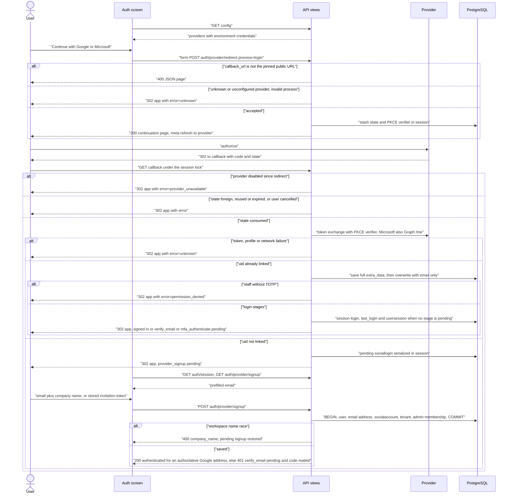

# Sign in or sign up with Google or Microsoft

An anonymous visitor on the `/app/` sign-in screen clicks a provider button; a native form post sends the browser to Google or Microsoft, and the backend callback exchanges the code (PKCE) and bounces back to `/app/?social_callback=1`. A known identity signs in (subject to email verification and MFA stages); an unknown identity leaves a pending `provider_signup` in the session, which the screen completes with a company name (new workspace, user becomes its administrator) or a workspace invitation token (no membership until explicit acceptance).

## Entry points

- Screen: `web/src/components/auth.tsx` `Auth` (rendered by `dashboard.tsx` `DashboardView` when the session has no user) with `social-provider-buttons.tsx` `SocialProviderButtons` (`process="login"`, modes `login` and `register`) and `useSocialProviders`. Mode `socialSignup` is the completion form. `web/src/app/page.tsx` forwards a stray `/?social_callback=...` to `/app/`; after a completed sign-in `DashboardView` strips the marker (`app-entry-routing`).
- `GET /api/auth/browser/v1/config` -> allauth `ConfigView` (provider list through `SocialAccountAdapter.list_providers` and `list_apps`; a failed request hides the buttons silently).
- `POST /api/auth/browser/v1/auth/provider/redirect` (form-encoded native post, shared with `linked-accounts`) -> `pyracast.accounts.social_views.RedirectToProviderView`.
- `GET /api/accounts/google/login/callback/` and `/api/accounts/microsoft/login/callback/` -> `social_views.provider_callback` -> allauth `oauth2_callback` -> `social.SocialAccountAdapter.pre_social_login`.
- `GET|POST /api/auth/browser/v1/auth/provider/signup` -> `social_views.ProviderSignupView` (input `CompanySocialSignupInput`, extra fields from `forms.CompanySignupForm`); `GET|POST .../auth/provider/token` -> `social_views.disabled_provider_token` (404).
- Actors: anonymous user, identity provider. Owned by other flows: `GET auth/session` and `auth/2fa/authenticate` (`sign-in-and-sign-out`), `auth/email/verify` (`company-signup`), `POST /api/invitations/accept/` (`invitation-acceptance`). No command, job or script; mails go through `AccountAdapter.send_mail` inside the request (on commit), not a queue.

## Sequence

## Data

| Table | R/W | What |
| --- | --- | --- |
| `socialaccount_socialaccount` | R/W | Lookup by `(provider, uid)`; allauth first saves the full provider payload on the existing row, then `pre_social_login` overwrites `extra_data` with `{"email": ...}`; inserted at signup. Never matched by email. |
| `auth_user` | R/W | Staff/superuser and `is_active` checks and `last_login` on login; created at signup with an unusable password, never staff. |
| `account_emailaddress` | R/W | Uniqueness check at signup and verified check in the login stage; signup row is `verified` only for Google `@gmail.com` or `hd` accounts whose provider says verified. |
| `accounts_tenant` | R/W | Case- and space-insensitive name check in `clean_company_name`; insert for company signup (unique `unique_workspace_name`). |
| `accounts_membership`, `accounts_userlanguagepreference` | W | Administrator membership of the new tenant (none for invitation signup); language row only when the `pyracast_language` cookie holds an explicit language. |
| `accounts_workspaceinvitation` | R | `pending_invitation` validates token, email, expiry and not-accepted; never marked accepted here. |
| `mfa_authenticator` | R | Staff TOTP requirement and the `mfa_authenticate` stage. |
| `django_session` | R/W | OAuth states (`socialaccount_states`), pending `socialaccount_sociallogin`, login stages, login. |
| `usersessions_usersession` | R/W | allauth `usersessions` purges stale rows and records the session on every completed login. |
| `pyracast_authentication_cache` | R/W | `signup` rate limit counter and the verification mail limit (allauth ratelimit through the cache). |
| `socialaccount_socialapp`, `socialaccount_socialtoken` | none | Ignored: apps are built in memory from `SOCIALACCOUNT_PROVIDERS` (a stored `SocialApp` row has no effect), the token is dropped in `pre_social_login`. |

## Authorization

- CSRF: `CsrfViewMiddleware` on the redirect (hidden `csrfmiddlewaretoken`) and on the signup POST (`X-CSRFToken`). The callback GET carries no token; the state protects it.
- Provider enablement: only environment credentials (`settings.py` loop over `PYRACAST_{GOOGLE,MICROSOFT}_CLIENT_*`), checked in `SocialAccountAdapter.list_apps` (redirect form, config, pending deserialization), `provider_callback` and again in `pre_social_login`.
- Open redirect: `RedirectToProviderView.post` accepts exactly `PYRACAST_PUBLIC_ORIGIN + "/app/?social_callback=1"`. State: allauth stashes it in the session, bound to the provider, single use, 600 s TTL, about ten kept per session.
- Account takeover: `SOCIALACCOUNT_EMAIL_AUTHENTICATION`, `..._AUTO_CONNECT` and `SOCIALACCOUNT_AUTO_SIGNUP` are off, so a new identity always goes through the signup form.
- Administrators: `pre_social_login` refuses an existing staff or superuser identity without a TOTP authenticator; allauth MFA adds the `mfa_authenticate` stage for users with one.
- Workspace access: signup grants a tenant only through a new company; an invitation needs the separate, verified-email-checked acceptance. Database backstops: unique `(provider, uid)`, `unique_workspace_name`, `unique_verified_email`.

## Failure paths

| Condition | Result |
| --- | --- |
| `callback_url` differs (other host, port, scheme or query) | 400 JSON body shown as a page (native form post) |
| Missing or stale CSRF token | Django 403 page for the redirect form; 403 for the signup POST |
| Unknown or unconfigured provider or invalid `process` in the form; provider removed before the callback | 302 `/app/?social_callback=1&error=unknown`; 302 `error=provider_unavailable`; `callbackError` notice |
| State foreign, reused, expired or for another provider; provider `error`; token, profile or network failure | 302 with `error` (`cancelled` for `access_denied`, else `unknown`), generic `callbackError` |
| Existing staff identity without TOTP | 302 `error=permission_denied`, no session |
| Existing identity whose user is deactivated | 302 `error=unknown`, no session (allauth `pre_login`; not covered by a test) |
| Unverified email on existing identity, or TOTP present | Pending `verify_email` or `mfa_authenticate`, screen switches mode |
| Another request of the same session holds the lock for 5 s | 429 `session_busy` JSON, shown raw when it hits the callback or the form post |
| Signup GET or POST without pending signup (expired, disabled provider) | 409; the mount-time prefill GET swallows it silently (email stays empty), a POST shows the generic request error and consumes no signup quota |
| Signup rate limit (`5/h/ip`, shared with password signup) | 429 JSON |
| Missing company name without token; taken name; bad invitation; missing email | 400 field errors (`company_name`, `email`, non-field invitation message) |
| Unique name race on insert | 400 `company_name`, transaction rolled back, pending signup restored; any other `IntegrityError` propagates (500) |
| Email of an existing account | No new user; allauth enumeration prevention answers 401 `verify_email` pending and mails "account already exists"; pending signup is gone (read from allauth source; the test accepts 400 or 401) |
| Token login (`auth/provider/token`), stock `/api/accounts/
/login/` | 404 (a token POST without CSRF token gets 403); other methods on the token route and non-GET on the callbacks 405 |

## Rules and invariants

- Callback URL and redirect URI are separate: the browser returns to the pinned `/app/?social_callback=1`, which must also pass allauth `is_safe_url` (request host, `PYRACAST_HOSTS` or `PYRACAST_CSRF_ORIGINS`); the provider redirect URI is built from the request host and scheme (URL names `google_callback`, `microsoft_callback`), so production relies on `PYRACAST_TRUST_PROXY=1` (`deploy/compose.yaml`).
- A provider authorize URL on another host is returned as a 200 same-origin continuation page (`accounts/provider_redirect.html`, `no-store`, `no-referrer`, cookies copied) because the `/app/` document's CSP (`web/src/proxy.ts`, `form-action 'self'`) would block a cross-origin redirect after a form post. Same-host and non-redirect responses pass through.
- The callback runs under `SessionRequestSerialization` (per-session advisory lock, 5 s wait, else 429 `session_busy`), so the token exchange holds that lock. The session cookie must stay `SameSite=Lax` for the top-level callback GET.
- The state is consumed and the session saved before the token exchange; a callback that obtains an identity clears any earlier pending signup before the lookup. Google identity comes from the ID token in the token response (userinfo request only when it is missing); Microsoft needs the Graph profile request.
- Only an email survives in `extra_data`; access and refresh tokens are never stored (`SOCIALACCOUNT_STORE_TOKENS=False`, `sociallogin.token=None`). Google mailbox authority: `@gmail.com` or an `hd` claim, and the provider's own verified flag. Microsoft addresses are never trusted; the email falls back to `mail`, then `userPrincipalName`, then empty.
- Signup is all or nothing: `workspace_signup_transaction` wraps user, email, social account, tenant and membership in one transaction with a savepoint that maps only `unique_workspace_name`. Order on POST: rate limit, pending check (409), validation (400), save.
- `UnavailableSocialAppError` is a `ValueError` on purpose: allauth treats it as an expired pending signup (409) once the provider is disabled.
- The invitation token comes from `sessionStorage` (`pyracast.workspaceInvitation`), survives the provider round trip and hides the company field.

## Tests

- `tests/test_social_accounts.py`: continuation page and escaping, local redirect passthrough, config listing, atomic workspace signup for both providers, Google email authority, no email matching, staff and MFA on existing identity, state binding and single use, callback URL rejection, disabled token and stock login routes, method restrictions, provider disabling, rate limit, name race restore, unrelated failure, Microsoft UPN fallback, environment credentials, invitation signup with explicit acceptance, network failure. `tests/test_configured_social_apps.py`: in-memory apps, incomplete credentials.
- `web/tests/social-auth.spec.ts` (mocked API): button form fields and layout, hidden unconfigured providers, invitation restore without password, callback error notice, rejected email message, Turkish 320 px fit. `web/tests/auth-registration.spec.ts`: pending `provider_signup` precedence. `web/tests/public-site.spec.ts`: root forward of `social_callback`. `web/integration/social-auth.spec.ts`: real backend up to the provider authorize page under strict `form-action`.
- Gaps: no full round trip against the real backend; the Google ID-token path is never exercised (the fixture returns no `id_token`, so the userinfo fallback runs); the existing-email signup response is asserted as "400 or 401" while the browser test mocks a 400 `email_taken`; no test for a deactivated user or an unverified email on an existing identity; no browser test for 409 expiry, `permission_denied` or the 400 origin mismatch.
