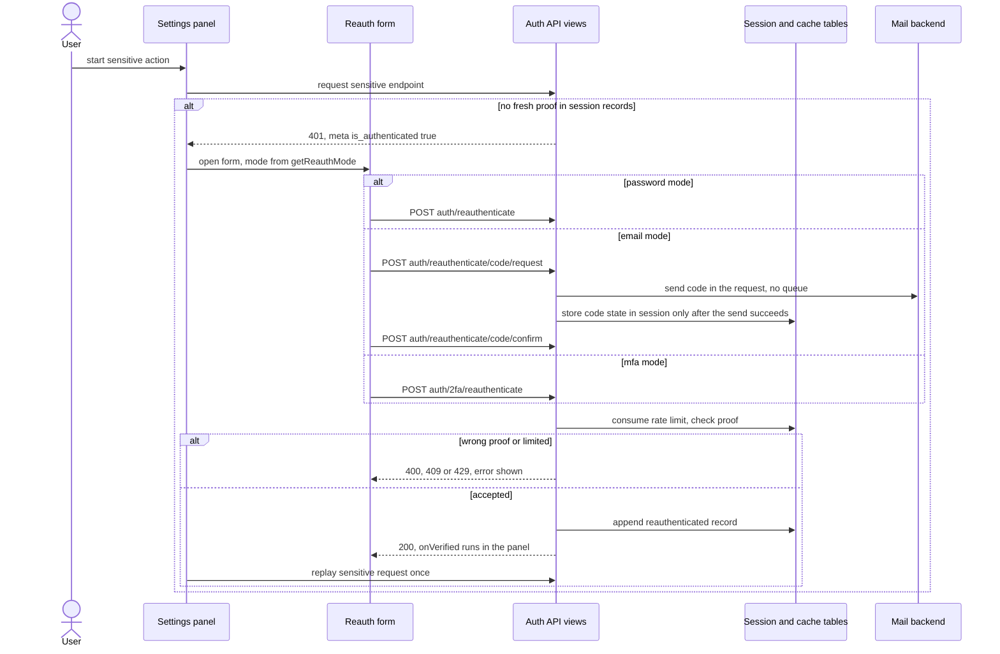

# Reauthenticate before a sensitive account change

A signed-in user attempts a sensitive account operation (set a first password, enrol or remove TOTP, view or regenerate recovery codes, unlink Google or Microsoft) and the API answers 401 because no fresh proof exists. The settings panel opens `ReauthenticationForm` in password, authenticator-code or emailed-code mode; success records a proof valid for 300 seconds and the panel replays the original operation once. Linking a provider asks for proof before any request and then shows the provider buttons instead of replaying. Login itself never counts as proof.

## Entry points

- UI: `web/src/components/security-reauthentication.tsx` `ReauthenticationForm`, hosted by `account-security.tsx` (`changePassword`), `two-factor-settings.tsx` (`handleAuthenticated401`, `executeOperation`) and `linked-accounts.tsx` (`disconnect`, connect button). Email change in `dashboard.tsx` shows a message and has no form.
- `POST /api/auth/browser/v1/auth/reauthenticate` -> `pyracast.accounts.headless.ReauthenticateView` (allauth view with `inputs.ReauthenticateInput`: password not stripped, max 1024); the explicit route precedes the allauth include in `pyracast/urls.py`.
- `POST .../auth/2fa/reauthenticate` -> allauth MFA `ReauthenticateView` (unmodified; TOTP or recovery code).
- `POST .../auth/reauthenticate/code/request`, `.../code/confirm` and `.../code/resend` -> allauth `RequestReauthenticationCodeView`, `ConfirmReauthenticationCodeView`, `ResendReauthenticationCodeView` (resend: no web caller, always 409).
- Gates that produce the 401: `pyracast.accounts.mfa_views` (`ManageTOTPView`, `ManageRecoveryCodesView`, `require_mfa_reauthentication`) and allauth flows calling `raise_if_reauthentication_required`; config in `pyracast/settings.py` (`ACCOUNT_REAUTHENTICATION_*`, `MFA_REAUTHENTICATION_REQUIRED`, `SOCIALACCOUNT_REAUTHENTICATION_REQUIRED`).

## Sequence

## Data

| Table | R/W | What |
|---|---|---|
| `django_session` | R/W | `account_authentication_methods` records (`method`, `at`, `reauthenticated`, `id`, `type`) bound to `account_authentication_methods_user`; `account_email_reauthentication_code` (code, `at`, `failed_attempts`, `resend_count`) |
| `pyracast_authentication_cache` | R/W | Rate-limit counters (`reauthenticate`, `login_failed`, `request_login_code`) and the TOTP used-code marker, on the autocommit `auth_cache` connection |
| `auth_user`, `account_emailaddress` | R / row lock | Password check, verified recipients; `auth_user` `FOR UPDATE` in `ManageTOTPView` and `ManageRecoveryCodesView` |
| `mfa_authenticator` | R/W | MFA proof must reference a live row; `last_used_at` updated, a used recovery code marked in `data` |

## Authorization

- All reauth views require an authenticated session (`AuthenticatedAPIView`), else 401 with `is_authenticated` false. The method must be in `ACCOUNT_REAUTHENTICATION_METHODS`, else 403. CSRF is enforced on every POST (allauth browser views are not exempt).
- allauth gate `raise_if_reauthentication_required` (latest `reauthenticated` record of an enabled method younger than 300 s): first password set (only without a usable password), TOTP activation, email add, remove or primary change, social disconnect and connect (rechecked by `RedirectToProviderView` before the redirect and by `SocialAccountAdapter.connect_account` at the callback). GET `account/authenticators`, `account/authenticators/totp` and `account/providers` are not gated.
- Stricter gate in `mfa_views` for TOTP removal and recovery-code view (GET, HEAD) or regeneration (POST): an `mfa` record of type `totp` or `recovery_codes`, `reauthenticated`, younger than 300 s, whose `id` is a still-existing authenticator of the same user. Password or email-code proof returns 401 `mfa_reauthentication_required`. Regenerating recovery codes deletes the row a recovery-code proof points to, so viewing them again asks again.

## Failure paths

| Condition | Result |
|---|---|
| No session | 401, `meta.is_authenticated` false; `refreshExpiredSession` reloads `/api/session/`, message `sessionExpired` |
| No fresh proof | 401, `is_authenticated` true; `data.flows` or error code `mfa_reauthentication_required`; form opens (email change: message only). Linking with a lapsed proof: redirect with `error=reauthentication_required` before the provider, `error=permission_denied` at the callback |
| Wrong password or code, or code requested for an address not verified for the user | 400 with `param` `password`, `code` or `email` (`unknown_email`); field error plus alert |
| `login_failed` (password: IP and primary email; MFA: `mfa-auth-user-<pk>`) or `request_login_code` exceeded | 400 `too_many_login_attempts` |
| `reauthenticate` limit (10/min per user, shared by password and code request), or the same session's lock busy for 5 s | 429 (lock: `session_busy`, `Retry-After: 1`); generic request-failed message |
| Email code expired, exhausted (3 attempts) or never requested | 409; generic request-failed message, no resend control |
| Mail backend error on code request | Exception propagates (500, not run); no code state saved |
| Replay still 401 | `reauthStillRequired`: two-factor panel returns to its previous view; password form shows it inside the form; linked accounts show it above the still-open form |
| Administrator removes TOTP | 403 `PermissionDenied` before any reauth check; GET or POST `totp` is 403 from `PrivilegedAuthenticatorEnrollment` |

## Rules and invariants

- Window: 300 s from the latest `reauthenticated` record, not extended by use. Session idle (30 min) and age (12 h) limits still apply; logout drops the records with the session.
- Email code: 3 minutes (`LOGIN_BY_CODE_TIMEOUT` default), 3 attempts (the third wrong code ends the state), no resends (`LOGIN_BY_CODE_SUPPORTS_RESEND` unset). `AccountAdapter.send_mail` defers to `transaction.on_commit`, which runs at once because no request transaction is open; no queue.
- Limits stack: a password check also consumes `login_failed` (10/10m per IP, 5/10m per key); MFA proof consumes `login_failed` under `mfa-auth-user-<pk>`; `2fa/reauthenticate` and `code/confirm` have no `reauthenticate` decorator.
- Lock order: requests of one session serialize on an advisory lock (`session_lock` middleware) before `mfa_views` takes the `auth_user` row lock.
- TOTP activation never replays: after proof the form returns to enrolment and a fresh code must be entered; showing the new recovery codes then needs a separate MFA proof. Other operations get exactly one replay.

## Tests

- `tests/test_admin_recovery_security.py`: MFA gate against password proof, expiry at 301 s, invalid timestamps, deleted factor, user binding, HEAD, row-lock race, admin TOTP removal.
- `tests/test_auth_lifecycle.py`: login is not proof, wrong then right password, password proof for TOTP activation and email change, MFA proof for recovery codes. `tests/test_social_accounts.py`: password proof for link and unlink, email-code proof for an unlink, missing or expired proof at the callback.
- Gaps: Playwright (`web/tests/two-factor-settings.spec.ts`, `account-security.spec.ts`, `social-auth.spec.ts`) uses mocked routes only; no test for a wrong emailed or MFA code, the `reauthenticate` 429, email-code expiry or attempt exhaustion, resend, or `session_busy` on these endpoints (only on login); the form's 409 handling is untested.
