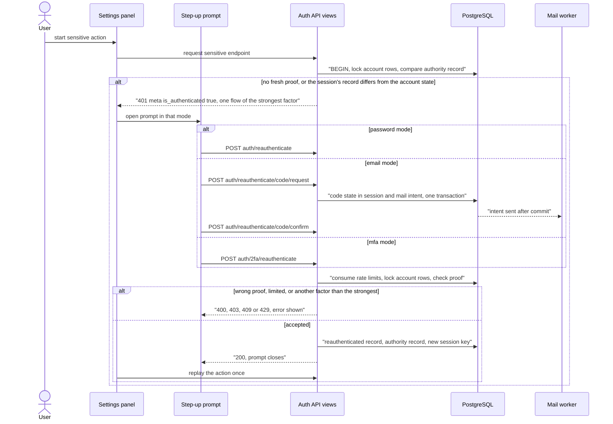

# Reauthenticate before a sensitive account change

A signed-in user attempts a sensitive account operation (set or change the password, add or remove an address, enrol or remove TOTP, view or regenerate recovery codes, connect or disconnect Google or Microsoft) and the API answers 401 because no fresh proof exists. One shared prompt opens with the factor the refusal names (authenticator, else password, else an emailed code); success records a proof valid for 300 seconds and the action that asked runs once more. Login itself never counts as proof, and a proof counts only while the account's credentials are as they were when it was given.

## Entry points

- UI: `web/src/features/account/step-up.tsx` (`stepUpMode`, `useStepUp`, `StepUpPrompt`) hosts `security-reauthentication.tsx` `ReauthenticationForm`; asking screens are `account-security.tsx` (`PasswordChange`), `two-factor-settings.tsx`, `linked-accounts.tsx` and `email-change.tsx`.
- `POST /api/auth/browser/v1/auth/reauthenticate` -> `pyracast.accounts.headless.ReauthenticateView` (allauth view with `inputs.ReauthenticateInput`: password not stripped, max 1024; runs in `processes.confirmation`).
- `POST .../auth/2fa/reauthenticate` -> `pyracast.accounts.mfa_views.ReauthenticateView` (`inputs.SecondFactorReauthenticateInput`: TOTP or recovery code; also in `confirmation`).
- `POST .../auth/reauthenticate/code/request` -> `headless.RequestReauthenticationCodeView`; `.../code/confirm` -> `ConfirmReauthenticationCodeView`. No resend route exists.
- `POST /admin/confirm/` -> `platform_admin.access.confirm`: the console's own authenticator confirmation (`ConfirmationForm`), recorded as the same proof.
- Each of these views (not the console form) accepts only the account's strongest factor (`step_up.StrongestFactor`, `security.strongest_factor`); any other answers 403.
- Gates that produce the 401: `processes.authorize_credential_write` (via `credential_write`) in the password, address, TOTP, recovery-code, provider and address-completion views; allauth's gate through `AccountAdapter.is_reauthentication_required` (`ACCOUNT_REAUTHENTICATION_*`, `MFA_REAUTHENTICATION_REQUIRED`, `SOCIALACCOUNT_REAUTHENTICATION_REQUIRED` in `src/pyracast/settings.py`); `step_up.require_recent_mfa` over `security.has_mfa_evidence(within=CONFIRMATION)` for TOTP removal, recovery codes and a password change of an account with an authenticator; every unsafe console request checks the same window in `PlatformAdminSite` (flow `admin-console-access`). `step_up.StepUpAnswers` turns allauth's reauthentication answer into the step-up 401.

## Sequence

## Data

| Table | R/W | What |
|---|---|---|
| `django_session` | R/W | `account_authentication_methods` records (`method`, `at`, `reauthenticated`, `id`, `type`); the authority record `pyracast_session_authority` (`[account, credential state]`); the pending code state (`REAUTHENTICATION_CODE_SESSION_KEY`: code, `at`, `failed_attempts`) with the state stamp it was sent under; the key is rotated by each proof |
| `usersessions_usersession` | R/W | The session's device row is replaced when its key rotates |
| `pyracast_authentication_cache` | R/W | Rate-limit counters (`login_failed`, `login_failed_ip`, `request_login_code`, allauth's `reauthenticate`) and the TOTP used-code marker, on the autocommit `auth_cache` connection |
| `auth_user`, `account_emailaddress`, `socialaccount_socialaccount`, `mfa_authenticator` | R / lock | The credential state (`processes.account_state`) is read to compare and locked (`FOR NO KEY UPDATE`) by `credential_write` and `confirmation`; password and verified recipients are checked here; `mfa_authenticator` `last_used_at` updated, a used recovery code marked in `data` |
| `notifications_outboundmail` | W | The reauthentication code mail, stored in the request's transaction |

## Authorization

- All reauth views require an authenticated session, else 401 with `is_authenticated` false. A factor other than the strongest answers 403 before any check, rate-limit use or mail. CSRF is enforced on every POST.
- The gate accepts the latest `reauthenticated` record of method `password`, `code` or `mfa` younger than 300 s, and only while the session's authority record equals the account's credential state (`end_stale_reauthentication` clears the flag at the next request, the records and the sign-in stay). `credential_write` also answers the 401 when the record differs from the locked state, whether or not the request carried a proof. A session's own completed credential write keeps its record for the state it left.
- The stricter MFA gate asks for an `mfa` record of type `totp` or `recovery_codes`, `reauthenticated`, finite `at` younger than 300 s, whose `id` is a still-existing authenticator of the user. Regenerating recovery codes deletes the row a recovery-code proof points to, so viewing them again asks again.
- GET `account/authenticators` and `account/providers` are not gated.

## Failure paths

| Condition | Result |
|---|---|
| No session | 401 `is_authenticated` false; `refreshExpiredSession` reads `/api/session/`, message `sessionExpired` |
| No fresh proof | 401 `code` `not_authenticated`, `is_authenticated` true, `data.flows` one flow (`mfa_reauthenticate`, `reauthenticate` or `reauthenticate_by_code`), `errors[0].code` `mfa_reauthentication_required` or `reauthentication_required`; the prompt opens in that mode. A linking that lapses before the redirect answers 302 `error=reauthentication_required` |
| Proof by a factor other than the strongest | 403 |
| Wrong password or code, or code requested for an address not verified for the user | 400 with `fields` `password`, `code` or `email`; field error plus alert |
| `login_failed` (password: primary email; MFA: `mfa-auth-user-<pk>`), `login_failed_ip` or `request_login_code` exceeded | 400 `too_many_login_attempts` |
| Allauth's `reauthenticate` limit, or the same session's lock busy for 5 s | 429 (lock: `session_busy`, `Retry-After: 1`, one client retry) |
| Email code expired, exhausted (3 attempts), never requested or ended by a credential change | 409; the form shows the answer's message and offers no resend |
| Session ended by another session during the proof | 400 `session_ended`; nothing is spent |
| Mail cannot be delivered | The request answers 200 with the code state saved; the worker retries the stored intent. A code whose session cannot be saved is not queued |
| Replay still 401 | `reauthStillRequired` shown in the prompt's host; an action that asks again while it resumes adds the `confirmAgain` notice |

## Rules and invariants

- Window: 300 s from the latest `reauthenticated` record, not extended by use. Session idle (30 days) and age (90 days) limits still apply; logout drops the records with the session.
- A password, authenticator or console confirmation checks its factor under the account's locks in `processes.confirmation`; the record, the key rotation and a spent recovery code commit together, so a confirmation whose session ended spends nothing. A code confirmation rests on the state its request stamped and ends with any change of it, including the account gaining an authenticator.
- Email code: 3 minutes (`ACCOUNT_LOGIN_BY_CODE_TIMEOUT`), 3 attempts (the third wrong code ends the state), no resends (`ACCOUNT_LOGIN_BY_CODE_SUPPORTS_RESEND` unset). The request locks the account's rows before validating the address, so a change started meanwhile waits and then ends the code; a request whose `request_login_code` budget for the typed address is spent takes no lock and answers 400.
- Limits stack: a password check consumes `login_failed` (5/10m and 100/d per key) and keeps a `login_failed_ip` slot (10/10m per IP) when it fails; an authenticator or recovery code consumes `login_failed` under `mfa-auth-user-<pk>` and keeps a `login_failed_ip` slot for a wrong code, released on success.
- Lock order: session advisory lock (whole request), then the account's rows, then the session row.
- The prompt is one per screen: it resumes only the action that asked, once, in its tab and for the session that asked (a changed session tag cancels it); TOTP activation resumes into a fresh code entry.

## Tests

- `tests/test_step_up.py` (strongest factor only, step-up answers, retained weaker proofs, state-bound proofs, code state), `tests/test_session_authority.py` (records at sign-in and confirmation, ended sessions), `tests/test_session_lifecycle.py` (key rotation), `tests/test_pending_process_authority.py` (reauthentication code ends with the account's state), `tests/test_console_step_up.py` (console confirmation), `tests/test_authentication_limits.py` (second-factor limits), `tests/test_auth_lifecycle.py` (login is not proof, password whitespace), `tests/test_social_accounts.py` (link and unlink proof).
- Playwright `web/tests/account-security.spec.ts`, `two-factor-settings.spec.ts` and `social-auth.spec.ts` (shared prompt, factor named by the server, resume once) use mocked routes; `web/integration/auth-security.spec.ts` runs against a real backend.
