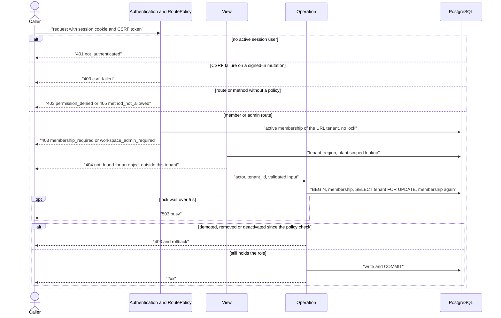

# Tenant, role and platform-administrator authorization

Every API request carries an allauth browser session and is checked in up to three places: the route's access policy, a tenant scope in the view or queryset, and a role check inside the application operation under a tenant row lock. A workspace has one `admin` and any number of `viewer` members; the platform administrator (active staff superuser with a verified second factor) is not a tenant member and works only through `/admin/`. The outcome is a 401, 403 or 404 before any write, or an operation scoped to the URL tenant.

## Entry points

- `ROUTE_POLICIES` in `src/pyracast/api/permissions.py`: access (`public`, `account`, `member`, `admin`) and optional throttle per route pattern and method, applied by the one default permission class `RoutePolicy` (`REST_FRAMEWORK` in `src/pyracast/settings.py`). A route without a policy is refused; a method the route does not list answers 405.
- Guards in `src/pyracast/accounts/authorization.py`: `tenant_membership` (optional role, optional tenant lock), `authorize_workspace_admin`, `is_platform_admin`, `require_platform_admin`, `has_platform_admin_session`, `requires_admin_mfa`.
- Tenant scope in views: `pyracast.api.views.tenant_region`, `ScopedView.plant_queryset` (`pyracast.plants.api`), `pyracast.plants.sites.site_queryset`, `TrashedRegionsView.get_queryset`.
- Operator surfaces: `pyracast.platform_admin.site.PlatformAdminSite.has_permission` guards `/admin/`; its console views pass `platform=True` to the shared workspace operations; `pyracast.api.session.SessionUserOutput.get_can_admin`. Commands `import_historical_reference`, `normalize_reference_capacity` and `restore_provider_snapshots` load a user by name and rely on `require_platform_admin`; `configure_plant` and `import_production` load one and need an administrator membership; `fixture_demo` (DEBUG only) needs a platform administrator and gives it an `admin` membership of its own demonstration tenant.
- Frontend: `WorkspaceAccess` and `useCanManageWorkspace` in `web/src/ui/workspace-access.tsx`, provided by `features/workspace/workspace-shell.tsx` from `tenant.role` of `GET /api/tenants/` (`TenantsView`, polled every 120 s).

## Sequence

## Data

| Table | R/W | What |
| --- | --- | --- |
| `accounts_membership` | R | Role per (tenant, user); unique pair, one `admin` per tenant (partial unique). Written by invitation, removal and reassignment flows |
| `accounts_tenant` | R, `FOR UPDATE` | Lock row of every writer that checks a role (`tenant_membership(lock=True)`, `authorize_workspace_admin`), and of `reassign_workspace_admin`; first among the workspace rows |
| `auth_user`, `mfa_authenticator`, `django_session` | R; `auth_user` `FOR NO KEY UPDATE` before workspace rows where a transaction locks the person | `is_active` joined into membership queries; `is_staff`, `is_superuser`; `has_mfa_evidence` needs a live authenticator whose id is in the session's authentication records |
| `regions_region` | R | Only table below the tenant with `tenant_id`; plants and deeper rows reach it through `region_id` |

## Authorization

- Authentication: `pyracast.api.authentication.SessionAuthentication` ignores inactive users, enforces CSRF for signed-in mutations and sends `WWW-Authenticate: Session`, so an anonymous caller gets 401.
- Policy: `RoutePolicy` needs a signed-in user unless the route is `public`; `member` and `admin` routes need an active membership of the URL tenant (a non-member always gets `membership_required`, before any role check) and `admin` routes the `admin` role. It runs unlocked and reads take no lock. An unsafe method on a `member` route (change-request submit, withdraw, seen) reaches the operation, which decides by role.
- Operation: `tenant_membership` reads membership, takes the tenant lock only for a caller who has one, and reads it again, so a later demotion or deactivation wins over the policy. `role=viewer` refuses the admin on proposals; `withdraw_request` and `mark_seen` also check authorship by `proposer_membership_id`.
- Platform: `is_platform_admin` is active, staff and superuser; `has_platform_admin_session` adds `has_mfa_evidence`, and an unsafe console request also needs a recent confirmation (`recent=True`). On `/api/tenants/` routes a platform administrator is an ordinary user and needs a membership. Shared workspace operations take `platform=True` only from the console: `authorize_workspace_admin` then checks `require_platform_admin` and locks the tenant row, with no membership. EPIAS connect and disconnect, provider setup, review decisions and administrator reassignment require `require_platform_admin` (no tenant API route reaches them); `GET .../production-source/` needs membership.
- Database: unique and single-admin constraints only; no row-level security. UI: `WorkspaceAccess` defaults to `false` (read-only) and is advisory.

## Failure paths

| Condition | Result |
| --- | --- |
| Anonymous or inactive user | 401 `not_authenticated` |
| Signed-in mutation without a valid CSRF token | 403 `csrf_failed` |
| Caller not an active member of the URL tenant (platform administrator included, unknown tenant too) | 403 `membership_required` |
| Member without the `admin` role on an admin route | 403 `workspace_admin_required` |
| Admin submits a change request | 403 `admin_edits_directly` |
| Operator operation without active staff superuser | 403 `platform_admin_required` |
| Route without a policy; method the route does not list | 403 `permission_denied`; 405 `method_not_allowed` |
| Row not in the URL tenant, trashed meanwhile, or a request the caller did not propose under the current membership | 404 `not_found` from `get_object_or_404` in a view or `.get()` in an operation |
| Demoted, removed or deactivated between policy and operation | 403 (`workspace_admin_required` or `membership_required`) and rollback |
| Tenant lock not acquired within 5 s | 503 `busy`, `Retry-After: 1` |

A signed-in 403 also writes an `authorization_denied` or `csrf_refused` security line (`docs/flows/audit-trail.md`).

## Rules and invariants

- Lock order ([decision record](../ARCHITECTURE.md#tenancy-and-authorization)): a person's account rows before the workspace rows, which start at `accounts_tenant`, then region, plant, request rows. Member removal first locks the member's account rows (`lock_account`), as the account processes do, and an outsider never queues for the tenant lock. Every role check takes the tenant lock first, so a reassignment waits for in-flight writers and later writers see the new admin.
- The policy is only a first gate; correctness depends on the repeat inside the operation.
- A proposal is bound to the membership id, so a removed and re-added member cannot recover old authorship. `lock_timeout` is 5 s, `statement_timeout` 60 s (`background/deadlines.py`, `DATABASES` in `src/pyracast/settings.py`).
- Role strings are `admin` and `viewer`; "member" in a policy means any active membership.
- `site_queryset` only prepares a tenant-filtered selection; access comes from the policy and the operations.

## Tests

- `tests/test_route_policy.py`: every routed view and method has one policy, the table equals the reviewed matrix, each role meets it over HTTP, unlisted routes and methods are refused.
- `tests/test_workspace_authorization.py`: viewer 403 on 19 mutating routes, every application mutation against viewer, outsider, platform, demoted and inactive actors, transfer-versus-writer race. `tests/test_authorization.py`: guards, an outsider not queueing for the tenant lock, list reads not waiting for it. `tests/test_change_request_boundaries.py`: member exception, non-admin decisions, deactivated actors.
- `tests/test_platform_workspace_authority.py` (console authority without membership, the tenant API treats the platform administrator as an outsider), `tests/test_platform_admin_agreement.py` (console, session and operations agree on active, staff, superuser and second factor), `tests/test_epias_authorization.py`, `tests/test_api.py` (cross-tenant), `tests/test_account_security.py` and `tests/test_step_up.py` (MFA evidence), `tests/test_session.py` (`can_admin`). Playwright: `web/tests/workspace-roles.spec.ts`, `web/tests/change-requests.spec.ts`.
