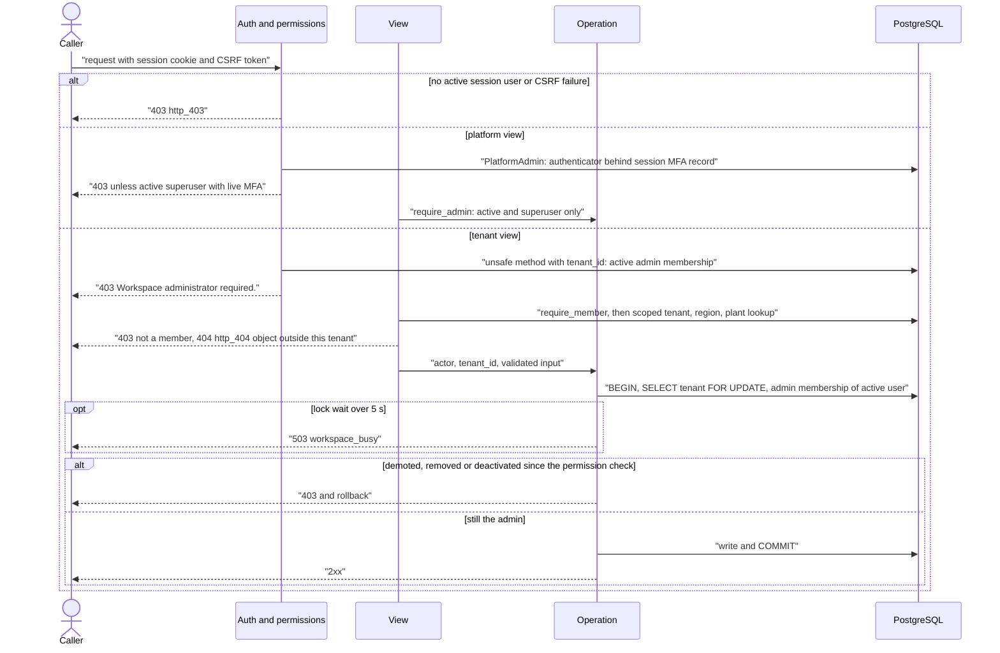

# Tenant, role and platform-administrator authorization

Every API request carries an allauth browser session and is checked in up to three places: a DRF permission class, a membership check in the view or queryset, and a role check inside the application operation under a tenant row lock. A workspace has one `admin` and any number of `viewer` members; the platform administrator (active superuser with verified MFA) is not a tenant member and works through `/api/platform/` and `/admin/`. The outcome is a 403 or 404 before any write, or an operation scoped to the URL tenant.

## Entry points

- Defaults, `REST_FRAMEWORK` in `src/pyracast/settings.py`: `SessionAuthentication`, `IsAuthenticated`, `pyracast.api.permissions.WorkspaceWritePermission`. `WorkspaceMemberWritePermission` replaces them on change-request submit, withdraw and seen (`src/pyracast/change_requests/api.py`).
- `pyracast.api.views.PlatformAdmin` on every `/api/platform/*` view and, through `check_permissions`, on PUT/DELETE of `pyracast.plants.epias_api.EpiasConnectionView`.
- Guards in `src/pyracast/accounts/operations.py`: `require_member`, `workspace_membership`, `require_workspace_member`, `require_workspace_admin`, `require_admin`.
- Member check plus tenant to region to plant scope: `pyracast.plants.api.ScopedView.plant_queryset`, `RegionsView.get_queryset`, `LocationChangeRequestsView.get_region`, `pyracast.api.trash` list views, `pyracast.plants.sites.site_queryset`.
- Operator surfaces: `pyracast.admin.PlatformAdminSite.has_permission`, `pyracast.api.session.SessionUserOutput.get_can_admin`; commands `import_historical_reference` and `normalize_reference_capacity` load an active superuser by username and rely on `require_admin` only; `fixture_demo` (DEBUG only) also gives that superuser an `admin` membership of its own tenant and passes `require_workspace_admin`.
- Frontend: `WorkspaceAccess` and `useCanManageWorkspace` in `web/src/components/workspace-access.tsx`, provided by `Workspace` in `web/src/components/dashboard.tsx` from `tenant.role` of `GET /api/tenants/` (`TenantsView`, polled every 30 s).

## Sequence

## Data

| Table | R/W | What |
| --- | --- | --- |
| `accounts_membership` | R | Role per (tenant, user); unique pair, one `admin` per tenant (partial unique). Written by invitation, removal and reassignment flows |
| `accounts_tenant` | R, `FOR UPDATE` | Lock row of `require_workspace_admin` (also on the admin-only GET of members and invitations), `workspace_membership(lock=True)`, `reassign_workspace_admin`; first in the lock order |
| `auth_user`, `mfa_authenticator`, `django_session` | R; `auth_user` `FOR UPDATE` in EPIAS connect/disconnect | `is_active` joined into membership queries; `is_superuser`; `has_verified_mfa` needs a live TOTP or recovery-code authenticator whose id is in the session's authentication records |
| `regions_region` | R | Only table below the tenant with `tenant_id`; plants and deeper rows reach it through `region_id` |

## Authorization

- Authentication: `SessionAuthentication` ignores inactive users and enforces CSRF; anonymous callers get 403, not 401.
- View, writes: `WorkspaceWritePermission` needs an active admin membership for unsafe methods when the URL has `tenant_id`; it passes when the kwarg is missing or named differently. View, reads: `require_member` (any role, no lock); a foreign id is 404 for a member and 403 for an outsider.
- Operation: `require_workspace_admin` re-reads membership under the tenant lock, so a later demotion or deactivation wins over the permission class. `require_workspace_member` rejects the admin on proposals; `withdraw_request` and `mark_seen` also check authorship by `proposer_membership_id`.
- Platform: `PlatformAdmin` needs active, superuser and `has_verified_mfa`; `require_admin` needs only active and superuser. On tenant URLs a superuser is an ordinary user (`require_workspace_admin` ignores superusers); EPIAS connect and disconnect are the only tenant URLs that admit the platform admin without membership, while its EPIAS GET still needs membership. `/api/platform/` and `/admin/` act on any tenant's regions by id. `/admin/` adds `is_staff`; `can_admin` needs `is_staff`, superuser and MFA.
- Database: unique and single-admin constraints only; no row-level security. UI: `WorkspaceAccess` defaults to `false` (read-only) and is advisory.

## Failure paths

| Condition | Result |
| --- | --- |
| Anonymous, inactive user, missing CSRF token | 403 `http_403` |
| Unsafe method, caller not the active tenant admin (platform admin included, unknown tenant too) | 403 `Workspace administrator required.` |
| Read by a non-member; GET members or invitations by a non-admin | 403 English `Tenant membership required.`; members and invitations answer `Workspace administrator required.` after taking the tenant lock |
| Admin submits a change request | 403 `Workspace members submit requests; administrators edit directly.` |
| Row not in the URL tenant; withdraw or seen of a request the caller did not propose under the current membership | 404 `http_404` when a view's `get_object_or_404` rejects it (`ScopedView.plant_queryset`, lookups on `RegionsView.get_queryset` and `site_queryset`, `LocationChangeRequestsView.get_region`); 404 `not_found` when an operation's `.get()` does (trash and restore, collection schedule, reminders, change requests including withdraw and seen, or a row trashed between the view check and the operation lock) |
| Demoted or deactivated between permission class and operation | 403 and rollback |
| Platform view or EPIAS PUT/DELETE without active superuser and live MFA; non-member on submit, withdraw or seen | 403 with DRF's default `You do not have permission to perform this action.` |
| Tenant lock not acquired within 5 s | 503 `workspace_busy`, `Retry-After: 1` |

## Rules and invariants

- Lock order starts at `accounts_tenant`, then region, plant, request rows. Every admin check takes the tenant lock first, so a reassignment waits for in-flight writers and later writers see the new admin.
- The permission class runs unlocked and is only a first gate; correctness depends on the repeat inside the operation.
- A proposal is bound to the membership id, so a removed and re-added member cannot recover old authorship. `lock_timeout` is 5 s, `statement_timeout` 60 s (`DATABASES` in `src/pyracast/settings.py`).
- Role strings are `admin` and `viewer`; "member" in `WorkspaceMemberWritePermission` means any membership.

## Tests

- `tests/test_workspace_authorization.py`: anonymous gate, viewer 403 on 26 mutating routes, every application mutation against viewer, outsider, platform, demoted and inactive actors, transfer-versus-writer race. `tests/test_change_request_boundaries.py`: member exception, non-admin decisions, deactivated actors.
- `tests/test_api.py` (cross-tenant, platform MFA), `tests/test_epias_authorization.py`, `tests/test_domain.py`, `tests/test_account_security.py` (MFA evidence), `tests/test_session.py` (`can_admin`). Playwright: `web/tests/workspace-roles.spec.ts`, `web/tests/change-requests.spec.ts`.
- Gaps: no test enumerates the URL conf; `production/changes/` and `production/preview/` are missing from the viewer parametrization; no HTTP test of `PlatformAdmin` with a superuser lacking `is_staff`.
