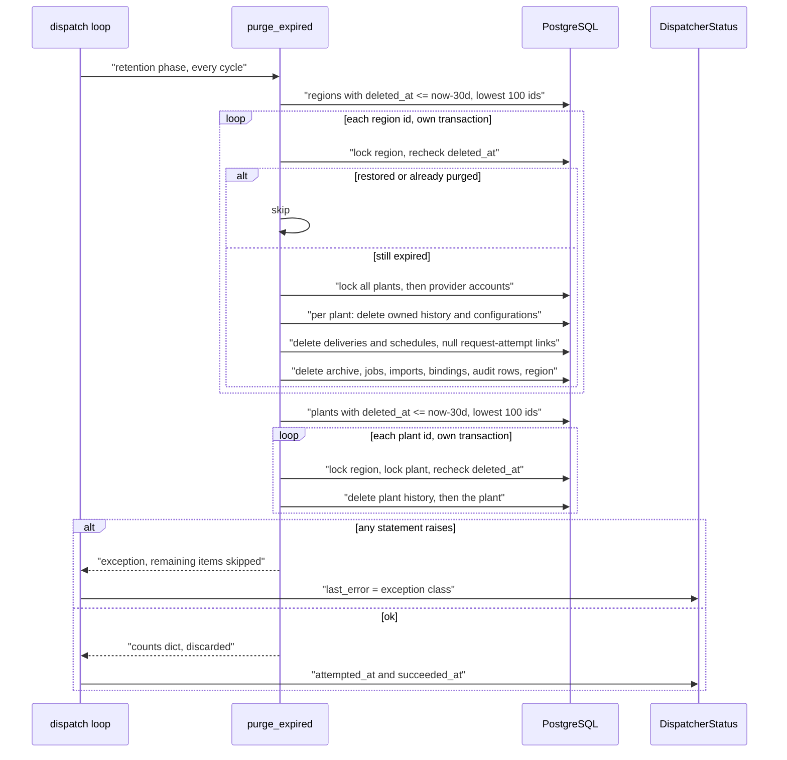

# Purge trashed sites and plants after 30 days

Every dispatcher cycle runs the `retention` phase, which hard-deletes regions and plants whose `deleted_at` is at least 30 days old, together with everything they own. Nobody calls it from the web or the API. The outcome is that the rows vanish from the recycle bin and can no longer be restored, while provider accounts and their request-attempt quota ledger survive.

## Entry points

- Command: `pyracast dispatch --loop` (`pyracast.forecasts.management.commands.dispatch` `Command.handle`) calls `pyracast.trash.purge_expired` as the fourth of five phases (notifications, collection, calibration, retention, metering). `deploy/compose.yaml` polls every 30 s, `scripts/dev.py` uses the 60 s default. Without `--loop` one cycle runs and a failed phase raises `CommandError`.
- Internals: `purge_expired` calls `_purge_region` (which calls `_purge_plant` per plant) and `_purge_plant` for individually trashed plants. A naive `now` raises `ValidationError`.
- Screen: none triggers it. `web/src/components/recycle-bin.tsx` `RecycleBin` shows `purge_after` and disables restore when `can_restore` is false (`pyracast.api.trash` `TrashedRegionOutput`, `TrashedPlantOutput`); a purged row vanishes on the next list load.
- Actor: the dispatcher process with the application database role. No user, tenant or queue message is involved.

## Sequence

## Data

| Table | R/W | What |
| --- | --- | --- |
| `regions_region`, `plants_plant` | R/W | Candidates by `deleted_at`, locked `FOR UPDATE`, deleted. A region purge takes every plant of the region, trashed or not |
| `connections_provideraccount` | R | Locked `FOR UPDATE` (pk order) for the region's bindings; never deleted |
| `forecasts_requestattempt` | W | `job` and `binding` set to NULL; rows kept so quota counters do not reset |
| `forecasts_collectionjob`, `forecasts_forecastsnapshot`, `forecasts_forecastresult`, `forecasts_referencecapacitynormalization`, `forecasts_historicalreferenceimport` | W | Region archive, deleted in the order normalization, result, snapshot, job, import |
| `forecasts_collectionschedule`, `notifications_reminderschedule`, `notifications_notificationdelivery` | W | Region schedules and all deliveries of the region |
| `connections_sitebinding`, `regions_auditevent`, `regions_regionlocationchangerequest` | W | Bindings (after `approved_binding` is nulled), region audit rows, location requests by cascade |
| `plants_plantconfiguration`, `plants_plantforecast`, `plants_forecastissuance`, `plants_productionobservation`, `plants_plantevent`, `plants_plantsubmission`, `plants_calibrationrun`, `plants_calibrationactivation` | W | Plant history; `current_configuration` and `comparison_activation` nulled first, submission by cascade |
| `metering_epias*` (snapshot, job, connection), `change_requests_changerequest`, `incidents_plantincident`, `incidents_incidentrevision` | W | EPIAS in that order; request items and incident changes by cascade |
| `forecasts_dispatcherstatus` | W | `retention` row: attempt, success, error class (`record_dispatch_phase`) |

## Authorization

- No per-user check: the phase selects rows only by `deleted_at`, across all tenants. Authorization happened when a workspace administrator trashed the item (`plant-trash-and-restore`).
- Database: foreign keys to `Region`, `Plant`, `SiteBinding`, `CollectionJob` and `ForecastSnapshot` are `PROTECT` except `CollectionSchedule.region`, `ReminderSchedule.region`, `RegionLocationChangeRequest.region` and `PlantSubmission.plant`, which cascade; deliveries and change-request items cascade only from their own parents (`ReminderSchedule`, `ChangeRequest`). A child the purge forgets raises `ProtectedError` instead of orphaning data. No trigger blocks deleting archives: the issuance guard (`0018_forecast_issuance`) fires on INSERT and UPDATE only.

## Failure paths

| Condition | Result |
| --- | --- |
| Candidate restored or purged elsewhere between listing and lock | Skipped silently: `deleted_at <= cutoff` is rechecked under the lock |
| Exception in an item (`ProtectedError`, 5 s lock timeout, 60 s statement timeout, lost connection) | Item rolls back and the call ends: a failing region skips the later regions and the whole plant batch, a failing plant only the later plants. Log `dispatch_phase_failed phase=retention`, `DispatcherStatus.last_error` = class name. The item is first in pk order again next cycle, so a stuck region blocks later regions and all plant purges, a stuck plant only later plants (regions still run first) |
| Failed phase without `--loop` | Other phases still run, then `CommandError` |
| Stale or failed phase | `delivery_health` lists `retention` in `unhealthy_dispatch_phases`; the admin overview shows "Retention" and `check_delivery_health` exits with `CommandError` |
| Restore after purge, or between deadline and purge | 404 `not_found`, or 400 `invalid_request` with detail "The 30-day restore period has ended." (`trash_retention_expired`); a taken location (region) or trashed parent (plant) is reported first |
| Queued collection message for a purged job | `claim` and `collect` return `None`/`False`; the `collect_forecast` actor's `deliver` raises `DoesNotExist` (`max_retries=0`) |

## Rules and invariants

- The boundary is inclusive and gapless: purge selects `deleted_at <= now - 30 days`, restore refuses when `now >= deleted_at + 30 days` (`RETENTION`, `_restore_deadline`), and the API's `purge_after` is the same instant. Re-trashing keeps the first `deleted_at`; restore clears it, so a later trash starts a new 30 days.
- Work per call is bounded: at most 100 regions, then at most 100 plants (`PURGE_BATCH_SIZE`), lowest pk first (not oldest `deleted_at`), one transaction per item. A backlog drains over several cycles.
- Lock order is region, plants by pk, provider accounts by pk, the same relative order as the collection commit (region, job, plant, account). Both purge kinds lock the region first (the plant purge locks a region it keeps), which serializes against restore, trash and worker commits. The tenant row is not locked. Deletion order follows the `PROTECT` graph; cyclic links are nulled first.
- Quota is never refunded: the account lock keeps reservations from interleaving, and attempt rows lose only their links. Purging a plant keeps its region's snapshots, jobs, reminders and audit rows. Purging a region removes its audit events, so `region_trashed` history ends with it.
- Counts are returned but neither logged nor stored: nothing records that a purge happened. A failed status write is logged as `dispatch_monitoring_failed`.

## Tests

- `tests/test_trash_operations.py`: boundary (microsecond before, exact deadline), region and plant graphs, quota ledger and sibling regions kept, batch size, naive clock, concurrent purge.
- `tests/test_trash_boundaries.py`: purge racing collection, reminder and calibration candidates before the region lock; purged queue ids ignored; phase order. Child graphs in `test_forecast_archive_core.py`, `test_timeseries_integrity.py`, `test_incidents.py`, `test_change_requests.py`, `test_region_editing.py`, `test_capacity_normalization_boundaries.py`, `test_site_onboarding.py`, `test_calibration_automation.py`; races in `test_notification_group_boundaries.py`, `test_notifications_races.py`, `test_metering.py`.
- `tests/test_trash_api.py`: expired rows stay listed with `can_restore` false and restore returns 400. Dispatcher tests (`test_dispatch_resilience.py`, `test_dispatch_recovery.py`, `test_runtime.py`, `test_shutdown_process.py`) mock `purge_expired`; `test_delivery_health.py` seeds a failed `retention` row by hand. Playwright `web/tests/workspace.spec.ts` "recycle bin disables expired records" mocks the API.
- Gaps: failing item blocking later ones, the plant batch bound, `deliver` for a purged job, new foreign keys to `Region` or `Plant`, volume or statement timeouts, and the command purging real rows are untested.
