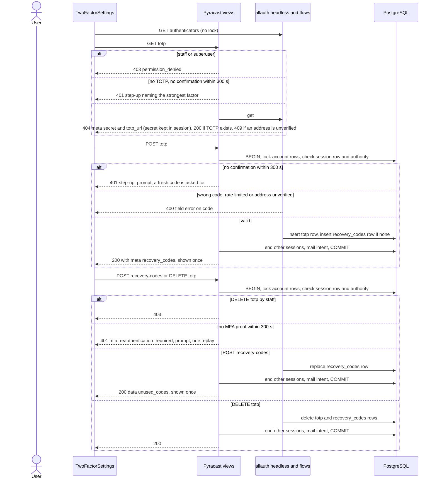

# Two-factor management

A signed-in customer opens Account settings to enrol a TOTP authenticator from a QR code, replace the one-time recovery codes, and remove the authenticator again. Each call is a django-allauth headless view; Pyracast subclasses the TOTP and recovery-code views to run each write in one transaction under the account's locks and to demand a fresh proof: any confirmation for enrolment, an authenticator confirmation for removal and recovery codes. Staff and superusers cannot self-enrol or remove TOTP (their factor comes from the operator command `bootstrap_admin`, flow `platform-admin-bootstrap`); they only manage recovery codes.

## Entry points

- `web/src/features/account/two-factor-settings.tsx` `TwoFactorSettings` (view state machine, hosted by `AccountSecurity`) with `authenticator-setup.tsx` `AuthenticatorSetup`, `recovery-codes.tsx` `RecoveryCodes`, the parts in `two-factor/` (`status-tag`, `load-error`, `enabled-panel`, `confirm-step`, `model.ts` `parseAuthenticators`) and the shared prompt `step-up.tsx` (`step-up-reauthentication`).
- `GET /api/auth/browser/v1/account/authenticators`: allauth `AuthenticatorsView` (type, dates, recovery-code counts); `GET|POST|DELETE .../account/authenticators/totp`: `pyracast.accounts.mfa_views.ManageTOTPView`; `GET|HEAD|POST .../account/authenticators/recovery-codes`: `ManageRecoveryCodesView`. The routes live in `accounts/auth_urls.py`; signal receivers in `accounts/sessions.py` and `accounts/audit.py`.

## Sequence

## Data

| Table | R/W | What |
|---|---|---|
| `mfa_authenticator` | R/W | One `totp` and one `recovery_codes` row per user (allauth `unique_authenticator_type`); TOTP secret Fernet-encrypted (context `pyracast-mfa-credentials-v1`, prefix `mfa:v1:`); recovery `data` holds `viewed_at` and the used mask. |
| `auth_user`, `account_emailaddress`, `socialaccount_socialaccount` | lock | The account's rows are locked with its authenticators (`account_state(lock=True)`) in every POST and DELETE and in recovery-code requests; never written here. Any unverified address blocks enrolment (allauth `validate_can_add_authenticator`). |
| `django_session`, `usersessions_usersession`, `pyracast_authentication_cache` | R/W | Pending TOTP secret, authentication records (`method`, `reauthenticated`, `at`, `type`, `id`; an activation adds an `mfa` record) and the authority record; `revoke_other_sessions` deletes the user's other sessions; `login_failed` counters on the autocommit `auth_cache` connection. |
| `notifications_outboundmail` | W | The activation, recovery-code and deactivation notices, stored as mail intents. |

## Authorization

- Anonymous callers get 401 `is_authenticated: false` from allauth `AuthenticatedAPIView.dispatch`, before the Pyracast `handle`; CSRF runs first.
- Staff and superusers: `ManageTOTPView.handle` raises `PermissionDenied` for every method, so `handler403` answers `{"code": "permission_denied"}` with `Cache-Control: private, no-store`; recovery codes stay open to them.
- Enrolment (GET totp for a secret, POST totp) needs one confirmation within 300 s by any factor (`judged_confirmation`, one clock reading per request); the secret is issued only after it. The activation code then counts as a confirmation by the new authenticator within the same window (`record_activation_proof`).
- Removal and recovery codes (GET, HEAD, POST) need `step_up.require_recent_mfa`: an MFA record (`totp` or `recovery_codes`, `reauthenticated`, finite `at` in the window) whose authenticator still exists for that user. Any 401 names only the account's strongest factor.

## Failure paths

| Condition | Result |
|---|---|
| Wrong code, or rate limited (`login_failed` under `mfa-auth-user-<pk>`: 5 per 10 min and 100 per day; no per-client allowance for enrolment) | 400, message on `code`; checked after the confirmation. A refusal by the limit keeps no slot; a refused code check after the limit writes `second_factor_locked` |
| No confirmation on GET or POST totp | 401 with the strongest factor's flow; the UI asks, and an activation then asks for a fresh code instead of replaying |
| No MFA proof on DELETE totp or recovery codes | 401 `mfa_reauthentication_required`, message "Enter your authenticator code or a recovery code."; password proof of an account with an authenticator is refused 403 at the reauthentication |
| Staff GET, POST or DELETE totp | 403 |
| Unverified address | 409 on GET totp, 400 on POST totp |
| Stored secret cannot be read | 403 `permission_denied`; line `mfa_secret_unreadable` |
| Same session busy for more than 5 s | 429 `session_busy`, `Retry-After: 1`, one client retry |
| Session ended by another session meanwhile | 400 `session_ended`; nothing is stored |
| Mail cannot be delivered | The stored intent is retried by the worker; the change is kept and the request answers as on success (`account-mail-notifications`) |
| Network or 5xx answer to an activation, replacement or removal | The UI re-reads the authenticator list to show the actual state |

## Rules and invariants

- Lock order: session advisory lock (whole request), then the account's rows in `processes.credential_write`, then the session row; the MFA freshness check runs after the locks, so a concurrent removal cannot slip in.
- Activation and replacement end the other sessions once, in their own transaction (`mfa_views.finish_factor_change`: `sessions_revoked`, reasons `mfa_added`, `mfa_reset`) and store their notice there; removal ends them through `authenticator_removed` (`mfa_removed`). The `mfa_*` lines leave with the commit, so a rolled-back write writes none. Any such change also ends every pending code or sign-in step of the account. Using a generated recovery code or showing codes ends none; using a recovery code migrated from another system removes it from the stored data and so ends them.
- Recovery codes are shown only by the answer that creates them (activation `meta.recovery_codes`, replacement `data.unused_codes`); a later GET answers counts. Activation creates codes only when none exist, and the screen never shows existing codes. Removing TOTP also deletes the recovery codes. A user who lost both factors is reset by the operator command `reset_mfa` (flow `platform-admin-bootstrap`).
- The UI hides setup and removal when `session.user.mfa_required`, offers Generate or Replace codes after a confirmation step, and shows added and last-used dates and the unused-code count.

## Tests

- `tests/test_authenticator_enrolment.py` (one confirmation, secret after confirmation, codes shown once, own-change authority), `tests/test_admin_recovery_security.py` (MFA gate, window, forged timestamps, HEAD, staff versus customer removal, cross-session serialization), `tests/test_step_up.py` (factor writes roll back whole, end other sessions once), `tests/test_auth_lifecycle.py` `test_totp_and_recovery_codes_gate_login_and_cannot_be_replayed`, `tests/test_authentication_limits.py` (enrolment limits), `tests/test_admin_mfa_bootstrap.py`, `tests/test_mfa_reset.py`, `tests/test_mfa_secrets.py`, `tests/test_account_session_revocation.py` (signal sent by hand), `tests/test_account_mail_content.py` (TOTP and recovery-code notices through the views); Playwright `web/tests/two-factor-settings.spec.ts`, `account-security.spec.ts` (mocked API) and `web/integration/auth-security.spec.ts` (real backend: enrolment, recovery-code sign-in).
