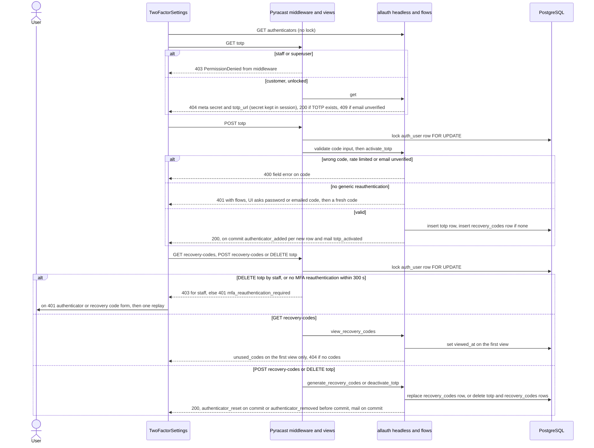

# Two-factor management

A signed-in customer opens Account settings to enrol a TOTP authenticator from a QR code, view or replace the one-time recovery codes, and remove the authenticator again. Each call is a django-allauth headless view; Pyracast subclasses the TOTP and recovery-code views to take a user row lock and, for removal and recovery codes, demand fresh MFA reauthentication. Staff and superusers cannot self-enrol or remove TOTP (their factor comes from `provision_admin_mfa`, flow `platform-admin-bootstrap`); they only manage recovery codes.

## Entry points

- `web/src/components/two-factor-settings.tsx` `TwoFactorSettings` (view state machine, hosted by `AccountSecurity`), with `authenticator-setup.tsx` `AuthenticatorSetup`, `recovery-codes.tsx` `RecoveryCodes` and `security-reauthentication.tsx` `ReauthenticationForm`.
- `GET /api/auth/browser/v1/account/authenticators`: allauth `AuthenticatorsView` (via `include("allauth.headless.urls")`); `GET|POST|DELETE .../account/authenticators/totp`: `pyracast.accounts.mfa_views.ManageTOTPView`; `GET|POST .../recovery-codes`: `ManageRecoveryCodesView` (HEAD guarded too); guard `pyracast.accounts.middleware.PrivilegedAuthenticatorEnrollment`; signal receivers in `accounts/sessions.py` and `accounts/audit.py`.

## Sequence

## Data

| Table | R/W | What |
|---|---|---|
| `mfa_authenticator` | R/W | One `totp` and one `recovery_codes` row per user (allauth `unique_authenticator_type`); TOTP secret Fernet-encrypted (HKDF context `pyracast-mfa-credentials-v1`, prefix `mfa:v1:`); recovery `data` holds `viewed_at`. |
| `auth_user` | lock | `FOR UPDATE` on the caller in POST/DELETE totp and GET/HEAD/POST recovery-codes; never written here. |
| `account_emailaddress` | R | Any unverified address of the caller blocks enrolment (allauth `validate_can_add_authenticator`). |
| `django_session`, `usersessions_usersession`, `pyracast_authentication_cache` | R/W | Pending TOTP secret and authentication records (`method`, `reauthenticated`, `at`, `type`, `id`); `revoke_other_sessions` deletes the user's other sessions; `login_failed` counters on the autocommit `auth_cache` connection. |

## Authorization

- Anonymous callers get 401 `is_authenticated: false` from allauth `AuthenticatedAPIView.dispatch`, before the Pyracast `handle`; CSRF runs before the middleware.
- Staff enrolment: `PrivilegedAuthenticatorEnrollment` (GET and POST on the exact `totp` path, not HEAD). Staff removal: `ManageTOTPView.handle`; `MFAAdapter.can_delete_authenticator` repeats it but only allauth's HTML `DeactivateTOTPForm` calls it. Both raise `PermissionDenied`, so `handler403` answers `{"code": "permission_denied"}` with `Cache-Control: private, no-store`.
- Generic reauthentication (a `reauthenticated` password, emailed-code or MFA record within 300 s; a plain login does not count) sits inside the allauth flows and covers enrolment. `require_mfa_reauthentication` adds a stricter check for removal and recovery codes: an MFA record (`totp` or `recovery_codes`, `reauthenticated`, finite `at` in the window) whose authenticator still exists for that user.

## Failure paths

| Condition | Result |
|---|---|
| Wrong code, or rate limited (`login_failed`: 5 per user key per 10 min) | 400, message on `code`; checked before reauthentication |
| No generic reauthentication on POST totp | 401 with flows, UI shows password or email-code form and does not replay |
| No MFA reauthentication on DELETE totp or recovery-codes (also with no factor at all) | 401 `mfa_reauthentication_required`, UI shows authenticator form |
| Staff GET/POST totp (middleware) or DELETE totp (view) | 403 |
| Unverified email | 409 on GET totp, 400 on POST totp |
| Same session busy for more than 5 s | 429 `session_busy`, `Retry-After: 1` |
| No recovery codes on GET after MFA reauthentication | 404, UI shows "Request failed (404)" |
| Mail backend error on a TOTP or recovery-code notification | Contained and logged by the account mail adapter (`account-mail-notifications`); the change is kept and the request answers as on success |

## Rules and invariants

- Lock order: session advisory lock (`SessionRequestSerialization`, whole request), then the `auth_user` row inside `transaction.atomic()`; allauth `generate_recovery_codes` locks the row again. The MFA freshness check runs after the lock so a concurrent removal cannot slip in.
- Activation and recovery replacement send their signals on commit; removal sends `authenticator_removed` inside the view's transaction. `AccountAdapter.send_mail` defers every mail to commit. Each add, remove or reset ends all other sessions of the user and logs an `mfa_*` event.
- Recovery codes are show-once: the first successful GET sets `viewed_at`, so a lost response is only fixed by replacing them. Activation creates codes without mail and records no MFA authentication, so the first view always asks for an authenticator or recovery code. Removing TOTP also deletes the recovery codes. No path resets a user who lost both factors; `provision_admin_mfa` refuses when any authenticator exists.
- The UI hides setup and removal when `session.user.mfa_required` and never replays an activation after reauthentication (the code is stale); after a network or 5xx error on activation, removal or replacement it re-reads authenticators to reconcile.

## Tests

- `tests/test_admin_recovery_security.py` (MFA window, forged timestamps, HEAD, 405, staff versus customer removal, cross-session row-lock serialization) and `tests/test_auth_lifecycle.py` `test_totp_and_recovery_codes_gate_login_and_cannot_be_replayed` (enrolment over HTTP, 401 before reauthentication, first recovery view needs MFA). Also `tests/test_admin_mfa_bootstrap.py`, `test_mfa_secrets.py`, `test_account_session_revocation.py` (signal sent by hand), `test_transactional_mail.py`; Playwright `web/tests/two-factor-settings.spec.ts`, `account-security.spec.ts` (fully mocked API). Gaps: no HTTP-level proof of session revocation or mail after activation, staff HEAD, wrong code before reauthentication, or first view without recovery codes; no Playwright run on a real backend.
