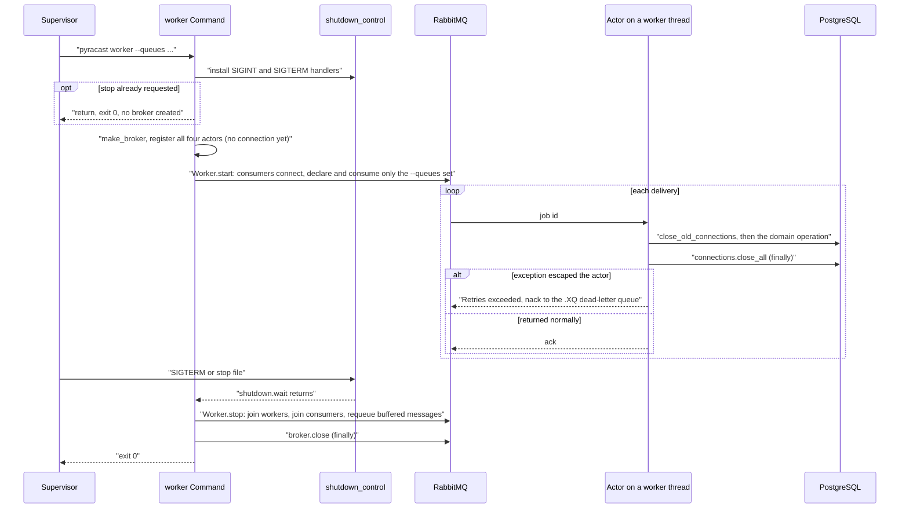

# Worker processes, RabbitMQ broker and graceful shutdown

A supervisor (systemd-managed Compose in production, `scripts/dev.py` locally) starts worker processes that consume Dramatiq messages from RabbitMQ and run the four job actors. Each message carries only a database id: PostgreSQL owns attempts, retries and five-minute leases, so a lost or duplicated message does not change the outcome. A signal or a stop file makes the worker stop consuming, drain active jobs and close the broker before exiting.

## Entry points

- Command `worker` (`src/pyracast/forecasts/management/commands/worker.py` `Command.handle`), run as `pyracast worker` through `src/pyracast/cli.py` `main` (defaults `DJANGO_SETTINGS_MODULE` to `pyracast.settings`; Compose sets `pyracast.production`) or locally as `python -m django worker`. Options: `--threads` (default 4), `--queues` (choices `default`, `calibration`, `epias`, `notifications`; default the first three), `--stop-file`.
- `src/pyracast/runtime.py` `make_broker` and `src/pyracast/shutdown.py` `shutdown_control`, both shared with `dispatch`.
- Actors, all `max_retries=0`: `collect_forecast` (queue `default`, `runtime.deliver`), `calibrate_plant` (`calibration`, `plants/runtime.py` `deliver_calibration`), `collect_epias` (`epias`, `metering/runtime.py` `deliver_epias`), `send_forecast_reminder` (`notifications`, `notifications/runtime.py` `deliver_notification`).
- `deploy/compose.yaml`: `worker` (`--threads 1`, `default calibration epias`), `notifications` (the mailer, `--threads 1`, `notifications`), both `restart: on-failure:5`, `stop_grace_period: 660s`, no health check, waiting for healthy `postgres` and `rabbitmq`; `rabbitmq` (digest-pinned 4.4.0, `broker.env`, no published port, grace 60 s, health check `rabbitmq-diagnostics -q check_running`).
- Local: `scripts/dev.py start` launches `worker` (4 threads) and `mailer` (2 threads, `--queues notifications`) with `--stop-file .dev/<role>.stop` after deleting a stale marker; `stop` calls `stop_cooperatively`. `ensure_dependencies` (re)starts the dev broker; `scripts/start_rabbitmq.py` starts it in Windows CI. Only `dispatch` (flow `dispatcher-cycle`) sends messages.

## Sequence

## Data

| Table | R/W | What |
| --- | --- | --- |
| `forecasts_collectionjob`, `connections_sitebinding`, `connections_provideraccount` | R | `runtime.deliver` loads the job, binding and provider account to pick the adapter and the optional Open-Meteo weather provider before `collect`. |
| Job tables of the owning flows | R/W | `forecasts.jobs.collect`, `plants.training.run_calibration`, `metering.jobs.run_epias_job`, `notifications.jobs.process_notification` claim and update `forecasts_collectionjob`, `plants_calibrationrun`, `metering_epiascollectionjob`, `notifications_notificationdelivery`. |
| RabbitMQ queues | R/W | Per queue name a durable queue plus `.DQ` (delay) and `.XQ` (dead letter, 7-day TTL), declared lazily when a consumer or publisher first uses it. |

## Authorization

- No user context. Authority is the process environment: `runtime.env` (database role, `PYRACAST_RABBITMQ_URL=amqp://pyracast:<password>@rabbitmq:5672/%2F`) and `broker.env`, both written as 0600 files under `/run/pyracast` by `deploy/runtime_secrets.py`. Every `x-process` service loads `runtime.env`, including `api` and `migrate`.
- `broker.env` carries `RABBITMQ_DEFAULT_USER=pyracast` and `RABBITMQ_DEFAULT_PASS`; the broker is reachable only on the Compose `application` network. Without `PYRACAST_RABBITMQ_URL`, `make_broker` silently uses `guest@127.0.0.1`.
- Tenant checks live in the operations the actors call, not in the runtime. The message id is trusted as is.

## Failure paths

| Condition | Result |
| --- | --- |
| `--threads` below 1, or a `--queues` value outside the choices | `CommandError` or argument error, exit non-zero before any broker is created |
| Stop file exists or signal arrives after handlers are installed, before start | Silent return, exit 0, no broker created |
| Broker unreachable at start or later | Process stays up: each consumer logs a critical error and restarts every 3 s; nothing is consumed meanwhile |
| Actor raises (deleted job row, unsupported provider, `lock_timeout`, database down) | Dramatiq logs "Failed to process message ... unhandled exception" and "Retries exceeded", nacks to `.XQ`; the row keeps what the operation committed and the dispatcher re-sends it while it stays due (an unsupported provider dead-letters every cycle) |
| Worker killed (SIGKILL, power, grace expired) | Unacked messages return to the queue; a `running` row is reselected after its lease expires |
| `Worker.stop` raises | Exception propagates, `broker.close` still runs, exit non-zero, Compose restarts it (up to 5 times) |
| Restart budget exhausted | Container stays down until `deploy/watchdog.py supervise` restarts it (only while `pyracast.service` is active and no release is blocked) |
| Dev stop does not finish in 300 s, or (no matching `--stop-file`) `wait_for_jobs` still sees `running`/`sending` rows after 300 s | `RuntimeError`; the process and its identity are kept. Without jobs, `terminate_tree` hard-stops a process lacking the marker |

## Rules and invariants

- Clock order: lease 5 min, drain up to 600 s per join phase (`Worker.stop` default), Compose grace 660 s, dev wait 300 s. The 60 s margin holds only if consumers join promptly after the workers. `deploy/install-release.sh` stops the dispatcher, then `worker notifications`, each with `-t 660`, before starting `rabbitmq`.
- Graceful stop is cooperative: the handler only sets a flag and `shutdown.wait` polls every 0.1 s, so no exception is injected into database work. The dev launcher's `terminate()` is a hard kill on Windows, so the stop file is its only graceful path. A second signal during the drain only sets the same flag, so only the supervisor timeout ends a stuck drain.
- Every worker registers all four actors but consumes only `--queues`. Production separates mail from provider work by process; one thread serves `default`, `calibration` and `epias`.
- Dramatiq prefetches `min(2 x threads, 65535)` messages per queue. Prefetched messages hold no lease until claimed and are requeued on stop. Each actor calls `connections.close_all` after every message, so `CONN_MAX_AGE` (60 s) has no effect in workers.
- Messages are duplicates by design: the dispatcher re-sends every due or lease-expired id each cycle, and the lease and idempotent publication decide who wins.
- No Dramatiq time limit is armed: `TimeLimit` starts only in `after_process_boot`, which `Worker.start` never emits (it emits `worker_boot`); only the `dramatiq` CLI does.

## Tests

- `tests/test_runtime.py`: worker arguments and queue selection, `--threads 0`, interrupt, broker close after a failing stop, handler restore, existing stop file, `make_broker` parameters and failover URLs.
- `tests/test_shutdown.py` (unit) and `tests/test_shutdown_process.py` (real subprocess, stub broker, worker and dispatch: active job finishes, then broker closes; the SIGTERM variant is skipped on Windows).
- `tests/test_dev_launcher.py`: cooperative stop, timeout keeps identity, foreign marker path, `wait_for_jobs` drain.
- `tests/test_live_queue.py`, `tests/test_calibration_runtime.py`, `tests/test_metering_runtime.py`, `tests/test_notifications_runtime.py`: real RabbitMQ delivery and redelivery, skipped unless `PYRACAST_LIVE_QUEUE=1`, which CI sets on Ubuntu (Docker RabbitMQ) and on both Windows shards (`scripts/start_rabbitmq.py` writes it to `GITHUB_ENV`); their other tests use stub brokers.
- `tests/test_deployment_watchdog.py` (exhausted worker recovery, Compose mocked) and `deploy/smoke.sh` (idle stop with `stop -t 30`).
- Gaps: nothing asserts the Compose `worker`, `notifications` and `rabbitmq` definitions. No test covers `deliver` with a deleted job or unsupported provider, a dead-lettered message, a drain longer than the lease, a hung provider call or the 660 s grace. No UI, so no Playwright coverage.
