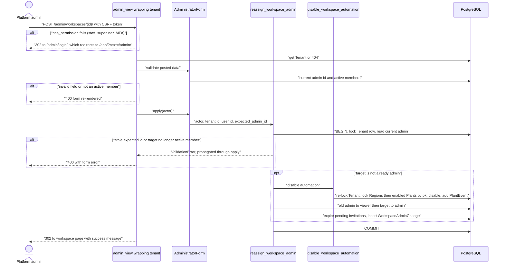

# List workspaces and reassign the workspace administrator

A verified platform administrator opens the Django admin console, browses workspaces (name, current administrator, member count) and picks another active member of one workspace as its single administrator. The transfer demotes the old administrator to viewer, promotes the chosen member, switches off every automatic calibration of the workspace, expires pending invitations and appends a `WorkspaceAdminChange` row. Nothing in `web/` or the REST API calls this flow.

## Entry points

- `GET /admin/workspaces/` -> `pyracast.admin.PlatformAdminSite.tenants` (`admin/workspace/tenants.html`) -> `pyracast.admin_tenants.tenant_list_context`. Query `q` (trimmed to 200 characters) filters `name__icontains`; `page` selects 20-row pages.
- `GET|POST /admin/workspaces/{id}/` -> `PlatformAdminSite.tenant` (`tenant.html`) -> `WorkspaceAdministratorForm.apply` -> `pyracast.accounts.operations.reassign_workspace_admin`. POST fields: `administrator` (user id), hidden `expected_admin_id`.
- Actor: active staff superuser with a verified MFA record in the session. Routes live in `PlatformAdminSite.get_urls`, mounted at `admin/` in `pyracast.urls`. No command, script or background trigger.

## Sequence

## Data

| Table | R/W | What |
| --- | --- | --- |
| `accounts_tenant` | R (lock) | Page lookup. `FOR UPDATE` row lock is the serialization point; the row is never changed. |
| `accounts_membership` | R/W | Current admin and candidates read; old admin set to `viewer`, target to `admin`. |
| `auth_user` | R | Active members in the choice list, re-checked via `user__is_active`. |
| `regions_region` | R (lock) | All regions of the tenant locked by pk, deleted or not. |
| `plants_plant` | R/W | Enabled plants: flag false, `automatic_calibration_enabled_by` and `next_calibration_check_at` null. |
| `plants_plantevent` | W | `calibration_automation_disabled` per disabled plant, actor is the platform admin. |
| `accounts_workspaceinvitation` | W | Unaccepted, unexpired invitations get `expires_at` set to now. |
| `accounts_workspaceadminchange` | W | Audit row: tenant, actor, new and previous administrator. No code reads it. |

## Authorization

- Site gate: `PlatformAdminSite.has_permission` needs active staff, `is_superuser` and `has_verified_mfa`; `admin_view` adds CSRF and `never_cache`. Failures redirect through `login` to `/app/?next=/admin/`.
- Operation gate: `require_admin` (active superuser) in `reassign_workspace_admin` and again in `disable_workspace_automation`; no MFA check there, so MFA is enforced only in the view layer. Target gate: the form queryset (active members of this tenant) and the operation's own lookup, which is authoritative.
- Database: partial unique index `one_workspace_admin` and check `valid_workspace_role`.

## Failure paths

| Condition | Result |
| --- | --- |
| Anonymous, inactive, non-staff, non-superuser or no verified MFA | 302 to `/admin/login/?next=<path>`, which redirects to `/app/?next=/admin/` (original path dropped) |
| POST without CSRF token (any identity; checked before the gate) / wrong method / unknown tenant id | 403 / 405 / 404 |
| `administrator` missing, inactive, or not a member of this tenant; non-integer `expected_admin_id` | 400, field error, form re-rendered |
| `expected_admin_id` differs from stored admin (blank counts as none) | 400, "The workspace administrator changed. Reload before saving." |
| Target deactivated or removed between form check and lock | 400, "Choose an active member of this workspace." |
| Target already administrator and expected id matches | 302 with the success message, nothing written |
| Tenant row gone between view lookup and lock | Unhandled `Tenant.DoesNotExist`, 500 (tenants are never deleted) |

## Rules and invariants

- Lock order: Tenant, then Regions by pk, then Plants by pk, in one `transaction.atomic` (`ATOMIC_REQUESTS` is off; `disable_workspace_automation` re-locks the Tenant in a savepoint). Memberships are not locked; the tenant lock and the partial index guard them. Demote precedes promote so the index never trips. Workspace-scoped writers take the same tenant lock first (`require_workspace_admin`), so they serialize with a transfer.
- `expected_admin_id` is an optimistic check read from a hidden field; a 400 re-render keeps the stale value, so retrying fails until the page is reloaded. A tenant with no administrator expects `None`, which a blank field satisfies.
- Reassigning to the current administrator is a no-op: no automation change, no invitation expiry, no audit row, yet the view reports success.
- Disabling covers every enabled plant of the tenant, trashed locations included. `automation._authorized` separately requires the enabling user to be the current active admin, so a returning administrator cannot revive old authorization. No session is ended and nobody is notified; effects apply per request.

## Tests

- `tests/test_admin_tenants.py`: access matrix, active-member filtering, success and message, stale expected id, CSRF/405/404, list search and pagination, username label fallback, form-level ValidationError.
- `tests/test_workspaces.py` (guards, invitation expiry, no-op, concurrent transfers, constraints), `tests/test_calibration_automation.py` (re-enable required, no revival), `tests/test_workspace_authorization.py` and `tests/test_change_request_concurrency.py` (serialization with writers), `tests/test_workspace_member_removal.py`, `tests/test_shared_reminder_schedule.py`, `tests/test_notifications.py`, `tests/test_change_request_boundaries.py` and `tests/test_change_requests.py` (review rights and counts move with the transfer).
- No Playwright test touches `/admin/workspaces/`. Gaps: the automation callout in `tenant.html`, POST on a tenant without administrator, soft-deleted plants in a transfer, username-only administrator in the list.
