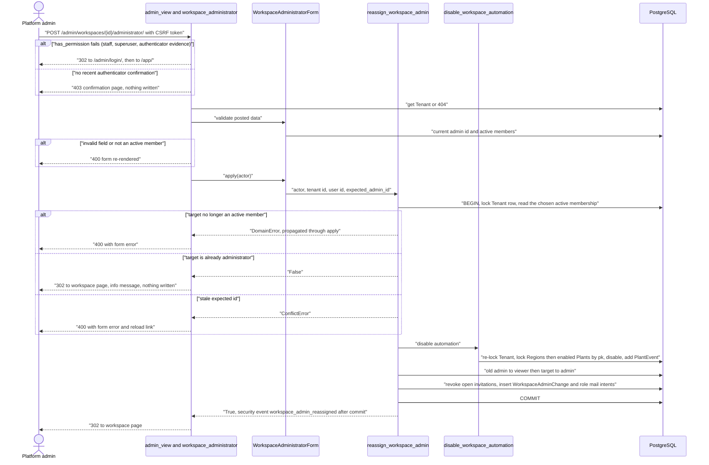

# List workspaces and reassign the workspace administrator

A verified platform administrator opens the Django admin console, browses workspaces and picks another active member of one workspace as its single administrator. The transfer demotes the old administrator to viewer, promotes the chosen member, switches off every automatic calibration of the workspace, revokes open invitations, mails both administrators and appends a `WorkspaceAdminChange` row. Nothing in `web/` or the REST API calls this flow.

## Entry points

- `GET /admin/workspaces/` -> `pyracast.platform_admin.tenant_views.workspaces` -> `pyracast.platform_admin.tenants.tenant_list_context`. Query `q` (trimmed to 200 characters) matches the workspace name or a member's email; `needs_administrator=1` keeps workspaces without an active administrator; `page` selects 20-row pages.
- `GET /admin/workspaces/{id}/` -> `tenant_views.workspace`: read-only; each active member links to the form with `?member=` preselected.
- `GET|POST /admin/workspaces/{id}/administrator/` -> `tenant_views.workspace_administrator` -> `WorkspaceAdministratorForm.apply` -> `pyracast.accounts.operations.reassign_workspace_admin`. POST fields: `administrator` (user id), hidden `expected_admin_id`. The page lists the consequences (`reassignment_impact`): who becomes a member ("New role of {member}: Member"), which plants lose automatic calibration, which invitations are revoked.
- Actor: active staff superuser with authenticator evidence in the session. Routes live in `PlatformAdminSite.get_urls`, mounted at `admin/` in `pyracast.urls`. No command, script or background trigger.

## Sequence

## Data

| Table | R/W | What |
| --- | --- | --- |
| `accounts_tenant` | R (lock) | `FOR UPDATE` row lock is the serialization point; the row is never changed. |
| `accounts_membership` | R/W | Current admin and candidates read; old admin set to `viewer`, target to `admin`. |
| `auth_user` | R | Active members in the choice list, re-checked via `user__is_active`. |
| `regions_region` | R (lock) | All regions of the tenant locked by pk, trashed or not. |
| `plants_plant` | R/W | Every enabled plant of the tenant, trashed locations included: flag false, `automatic_calibration_enabled_by` and `next_calibration_check_at` null. |
| `plants_plantevent` | W | `calibration_automation_disabled` per disabled plant, actor is the platform admin. |
| `accounts_workspaceinvitation` | W | Open unexpired invitations and any open administrator invitation, even expired: `revoked_at` now, `revoked_reason` `administrator_changed`; `expires_at` is kept. |
| `accounts_workspaceadminchange` | W | Audit row: tenant, actor, new and previous administrator. Read by the role mail and the record browser; also written when an administrator invitation is accepted. |
| `notifications_outboundmail` | W | `workspace_admin_assigned` and `workspace_admin_released` for the new and former administrator, only if active with a verified address; sent after the commit. |

## Authorization

- Site gate: the console gate (`admin-console-access`): an active staff superuser with MFA evidence for a live authenticator, a proof by the authenticator within the last hour for every request and a recent confirmation for every unsafe one. `admin_view` also adds CSRF, `never_cache` and `contained`. `PlatformAdminSite.login` sends an anonymous caller to `/app/?next=<console path>`, any other refused caller to `/app/`.
- Operation gate: `require_platform_admin` (active staff superuser, no authenticator check) in `reassign_workspace_admin` and `disable_workspace_automation`. Target gate: the form queryset and the operation's own lookup, which is authoritative.
- Database: partial unique index `membership_tenant_administrator_uniq`, check `membership_role_chk`, and `workspaceadminchange_administrator_chk` (new and previous administrator differ).

## Failure paths

| Condition | Result |
| --- | --- |
| Anonymous, inactive, non-staff, non-superuser or no authenticator evidence | 302 to `/admin/login/?next=<path>`, then to `/app/` |
| POST without CSRF token (any identity; checked before the gate) / unknown tenant id | 403 / 404 |
| Unsafe method without a recent authenticator confirmation | 403 confirmation page, nothing written |
| Wrong method (after the gate), including POST on the workspace page | 405 |
| `administrator` missing, inactive, or not a member of this tenant; non-integer `expected_admin_id` | 400, field error, form re-rendered |
| Target deactivated or removed between form check and lock | 400, "Choose an active member of this workspace." |
| Target already administrator (checked before the stale check) | 302, "<member> is already the workspace administrator.", nothing written |
| `expected_admin_id` differs from stored admin (blank counts as none) | 400, "The workspace administrator changed. Reload the page and try again." with a reload link |
| Lock timeout (5 s), deadlock or statement timeout | Nothing saved; retry message and redirect to the referring console page; JSON callers get 503 |
| Session already running another request | 503 page, `Retry-After: 1`; a write is never replayed |
| Tenant deleted between view lookup and lock (abandoned-signup reclaim only) | Unhandled `Tenant.DoesNotExist`, 500 |

## Rules and invariants

- Lock order: Tenant, then Regions by pk, then Plants by pk, in one `transaction.atomic` (`ATOMIC_REQUESTS` is off; `disable_workspace_automation` takes the Tenant lock again). Memberships are not locked; the tenant lock and the partial index guard them. Demote precedes promote so the index never trips. Workspace-scoped writers take the same tenant lock first (`tenant_membership(lock=True)`) and re-read the membership under it, so they serialize with a transfer.
- `expected_admin_id` is an optimistic check read from a hidden field; a 400 re-render keeps the stale value, so retrying fails until the page is reloaded. A tenant with no administrator expects `None`, which a blank field satisfies.
- Reassigning to the current administrator writes nothing: no automation change, revocation, audit row, mail or security event.
- Disabling covers every enabled plant of the tenant, trashed locations included, and no other workspace. `automation._authorized` separately requires the enabling user to be the current active admin, so a returning administrator cannot revive old authorization. No session is ended.

## Tests

- `tests/test_admin_tenants.py`: access matrix, active-member filtering, transfer and message, stale expected id, CSRF/405/404, list pagination, username fallback. `tests/test_workspace_search.py`, `tests/test_reassignment_impact.py` (consequence list), `tests/test_admin_workspace_management.py` (only a real change closes invitations and logs the event), `tests/test_console_step_up.py`, `tests/test_console_failures.py` (confirmation, retry).
- `tests/test_workspaces.py` (guards, no-op, concurrent transfers), `tests/test_workspace_ledger_constraints.py`, `tests/test_invitation_lifecycle.py` (revocation, audit constraint), `tests/test_review_mail.py` (role mail), `tests/test_calibration_automation.py` (re-enable required, no revival), `tests/test_workspace_authorization.py`, `tests/test_change_request_concurrency.py`, `tests/test_workspace_member_removal.py`, `tests/test_shared_reminder_schedule.py`, `tests/test_notifications.py`, `tests/test_change_request_boundaries.py`, `tests/test_change_requests.py` (serialization; rights and data move with the transfer).
- No Playwright test changes an administrator. Gap: a transfer with plants of a trashed location.
