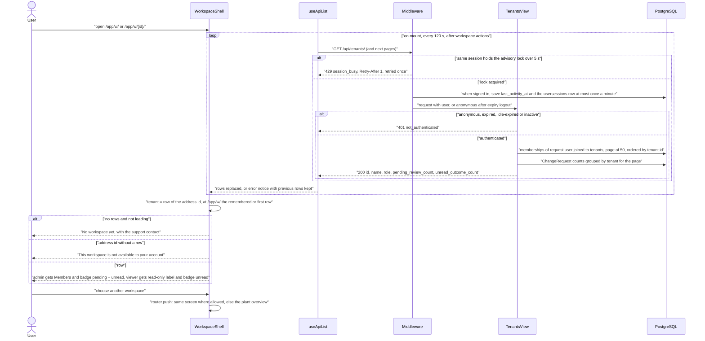

# Workspace list, inbox counters and switching

A signed-in customer opens `/app/`, which leads to `/app/w/<tenant>/`. The workspace shell reads `GET /api/tenants/` every 120 seconds. The response lists only the caller's own workspaces with the caller's role and two inbox counters. The shell renders the workspace selector, role-dependent sidebar entries, the `WorkspaceAccess` write context and the inbox badge. The active workspace is the id in the address, so switching navigates. A user without a membership sees an empty state.

## Entry points

- Screens: `web/src/features/session/entry.tsx` `Entry` at `/app/` sends a signed-in user to the account page after a provider return, to `/app/invitation/` while an invitation token is stored, to `/admin/` when the account can administer the platform, and otherwise to `/app/w/`. `web/src/app/app/w/page.tsx` renders `WorkspaceIndex`, which replaces the address with the workspace remembered in `localStorage` (`pyracast.workspace`) or the first row. `web/src/app/app/w/[tenantId]/layout.tsx` takes the id from the address (`routeId`, else 404). Both routes mount `web/src/features/workspace/workspace-shell.tsx` `WorkspaceShell` under `RequireUser`. The sidebar `<select>` switches workspace.
- Poll: `useApiList("/api/tenants/", {}, { poll: cadence.background })` (`web/src/lib/api/query.ts`) on a visible tab. It follows `next` links through all pages, and `pollInterval` stretches the period by the page count. Counters are computed per page.
- Immediate refetch: `useRefresh` (`refresh.workspace`, `refresh.requests`) invalidates the list after an inbox decision or read receipt, the Refresh list button, member and invitation actions, and plant or location changes.
- Endpoint: `GET /api/tenants/` -> `pyracast.api.views.TenantsView.get` (route in `src/pyracast/urls.py`, policy `ACCOUNT` in `pyracast.api.permissions.ROUTE_POLICIES`). Actor: any authenticated active user (workspace administrator or viewer). No command, job or external call.

## Sequence

## Data

| Table | R/W | What |
| --- | --- | --- |
| `accounts_tenant`, `accounts_membership` | R | Workspace id and name with the caller's role and membership id |
| `change_requests_changerequest` | R | Pending and unread decided requests per workspace |
| `plants_plant`, `regions_region` | R | Join path to the tenant; requests of a location in the trash (`regions_region.deleted_at` set) are excluded |
| `django_session` | R/W | `SessionLifetime` saves `last_activity_at` at most once a minute and flushes the session on expiry; `SessionRequestSerialization` holds a per-session advisory lock (no table) |
| `usersessions_usersession` | W | `record_activity` updates `last_seen_at`, IP and user agent with that minute marker, not on every poll |

## Authorization

- Authentication: `pyracast.api.authentication.SessionAuthentication` (treats inactive users as anonymous) and `RoutePolicy` from `REST_FRAMEWORK` in `src/pyracast/settings.py`. Scope: `TenantsView.get_queryset` filters `user` to `request.user`, so tenant isolation is a database filter. There is no tenant id in the URL; `is_superuser` grants nothing extra.
- Methods: `route_policy` lists GET for the route and HEAD follows it. A method without a policy, OPTIONS included, answers 405 `method_not_allowed` before the view runs. An authenticated POST, PUT, PATCH or DELETE without a CSRF token fails earlier with 403 `csrf_failed`.
- Frontend gating is cosmetic and derived from the polled `role`: sidebar entries, the pending count, and `WorkspaceAccess` (`screen === "account" || canManage`), which `useCanManageWorkspace` consumers such as `ActionForm` read to hide or disable write controls. The Members and Recycle bin pages replace themselves with the overview for a viewer (`AdminOnly`). Real checks are the route policy and the per-tenant operations (`tenant_membership`).

## Failure paths

| Condition | Result |
| --- | --- |
| Anonymous, expired, idle-expired or inactive session | 401 `not_authenticated` with `WWW-Authenticate: Session`; the client reads `/api/session/` at once and the shell gives way to sign-in with an expiry notice |
| Another request of the same session holds the lock over 5 s | 429 `session_busy`, `Retry-After: 1`, from the middleware before the view; the client waits and retries once, then shows the notice until the next successful poll |
| The request carries the tag of another session | 409 `session_changed` from `SessionTagCheck` before the view; the client repeats it once only if a session read shows the same session |
| User has no membership | 200 with `count` 0; empty state, selector shows "No workspaces", no inbox entry |
| First load fails | Error notice with a Retry button, no rows |
| A later poll fails, or a page repeats or leaves `/api/` | Request error or `Common.invalidPage`; previous rows kept with a refresh-failed notice |
| Address names a workspace the user lacks (removed, never joined) | "This workspace is not available to your account"; no fallback to another workspace. A role change applies on the next poll or refetch |
| Other method | See Authorization |

## Rules and invariants

- A user has at most one membership per workspace (`membership_tenant_user_uniq`), so the join yields one row per workspace. `membership_tenant_administrator_uniq` is a partial unique index: at most one administrator per workspace.
- `pending_review_count` is `null` for viewers and a number for administrators; the badge shows `pending + unread` for administrators and `unread` for viewers, for the shown workspace only. `unread_outcome_count` is computed for every role: requests the caller proposed whose `proposer_membership_id` is one of the caller's membership ids on the page, status approved or rejected, `outcome_seen_at` null. Rejoining a workspace therefore does not resurrect old unread outcomes. The rules live in `workspace_counters` and `visible_requests` (`src/pyracast/change_requests/policy.py`).
- Any authenticated request, including this poll, refreshes `last_activity_at` at most once a minute (`SessionLifetime`), so an open tab never idles out; the 12-hour absolute limit still applies. `docs/ARCHITECTURE.md` states this.
- At `/app/w/` the workspace is the remembered one (written to `localStorage` whenever a workspace address resolves) or the lowest id across all pages. The selector keeps the Inbox, and Members or Recycle bin when the target role is administrator, and otherwise opens the plant overview. Components keyed by tenant id (`MembersPage`, `RecycleBin`, and `OperationalInbox` by tenant id and role) remount and drop the previous tenant's data.

## Tests

- `tests/test_login.py`: membership-only listing, counter shape, empty list, anonymous 401, writes 405. `tests/test_change_request_boundaries.py` `test_tenant_poll_counters_follow_live_roles_and_personal_read_receipts` and `tests/test_change_request_policy.py` (counters of a trashed location, rejoined proposer): pending and unread counters across approval, read receipt, administrator reassignment and removal.
- `tests/test_route_policy.py` (HEAD, OPTIONS and unlisted methods), `tests/test_workspace_member_removal.py`, `tests/test_company_registration.py`, `tests/test_api_cache.py` (no-store headers). Session middleware, through other URLs: `tests/test_session_serialization.py` (429), `tests/test_session_lifecycle.py` (activity at most once a minute).
- Playwright (`web/tests`): `app-routes.spec.ts` (workspace in the address, reload and Back, unknown workspace), `workspace.spec.ts` (tenant pagination, session ended during polling), `change-requests.spec.ts` (badge from polled counters, role change on poll, switch clears tenant data), `workspace-member-removal.spec.ts` (refetch after failed removal, lost admin role, switch to a viewer workspace on Members, confirmation cleared on switch), `workspace-roles.spec.ts` and `responsive.spec.ts` (viewer read-only label, compact navigation).
- Gaps: no test for the empty state, a failed first load, the remembered workspace, more than 50 workspaces on the server, a 429 during polling, or an administrator's unread count.
