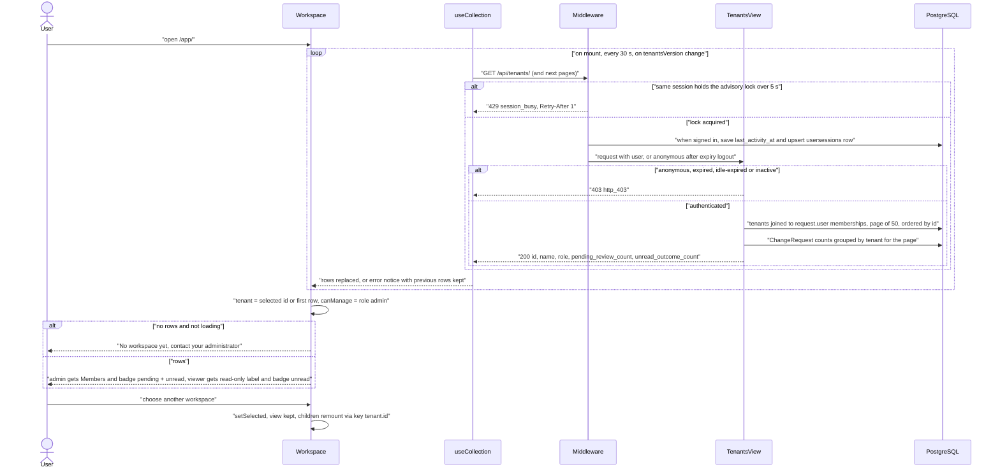

# Workspace list, inbox counters and switching

A signed-in customer opens `/app/`, whose shell polls `GET /api/tenants/` every 30 seconds. The response lists only the caller's own workspaces with the caller's role and two inbox counters. The shell renders the workspace selector, role-dependent sidebar entries, the `WorkspaceAccess` write context and the inbox badge, and switches the active workspace purely in the browser. A user without a membership sees an empty state.

## Entry points

- Screen: `web/src/components/dashboard.tsx` `Workspace` at `/app/` (`web/src/app/app/page.tsx` -> `Dashboard` -> `DashboardView`), mounted once `/api/session/` returns a user and no invitation token is pending, keyed by user id. Platform administrators are redirected to `/admin/` unless the URL asks for `?workspace=customer` or `?account=security`. The sidebar `<select>` switches workspace.
- Poll hook: `web/src/components/ui.tsx` `useCollection("/api/tenants/", tenantsVersion, 30_000)`, which follows `next` links through all pages (counters are computed per page).
- Immediate refetch: `refreshTenants` bumps `tenantsVersion` through the `ChangeRequestUpdates` context (`web/src/components/change-request-updates.tsx`) after a review or read-receipt action in `operational-inbox.tsx` and after a proposal in `outages.tsx` or `production-history.tsx`, and by `WorkspaceMembers.onAccessChange` only after a failed member removal.
- Endpoint: `GET /api/tenants/` -> `pyracast.api.views.TenantsView.get` (route in `src/pyracast/urls.py`). Actor: any authenticated active user (workspace administrator or viewer). No command, job or external call.

## Sequence

## Data

| Table | R/W | What |
| --- | --- | --- |
| `accounts_tenant`, `accounts_membership` | R | Workspace id and name with the caller's role and membership id |
| `change_requests_changerequest` | R | Pending and unread decided requests per workspace |
| `plants_plant`, `regions_region` | R | Join path to the tenant; trashed plants and regions (`deleted_at` set) are excluded |
| `django_session` | R/W | `SessionLifetime` saves `last_activity_at` at most once a minute and flushes the session on expiry; `SessionRequestSerialization` holds a per-session advisory lock (no table) |
| `usersessions_usersession` | W | allauth `UserSessionsMiddleware` (`USERSESSIONS_TRACK_ACTIVITY = True`) updates `last_seen_at`, IP and user agent on every authenticated poll |

## Authorization

- Authentication: DRF `SessionAuthentication` (treats inactive users as anonymous) plus `IsAuthenticated` from `REST_FRAMEWORK` in `src/pyracast/settings.py`. Scope: `TenantsView.get_queryset` filters `membership__user` to `request.user`, so tenant isolation is a database filter. There is no tenant id in the URL; `is_superuser` grants nothing extra.
- `WorkspaceWritePermission` (default permission class) lets every request without `tenant_id` through. Allowed methods are GET, HEAD (Django maps it to `get`) and OPTIONS (DRF metadata); they need no CSRF token but the same authentication. POST, PUT, PATCH and DELETE get 403 without a CSRF token (`SessionAuthentication` enforces CSRF) and 405 with one.
- Frontend gating is cosmetic and derived from the polled `role`: sidebar entries, the pending count, and `WorkspaceAccess` (`view === "profile" || canManage`), which `useCanManageWorkspace` consumers such as `ActionForm` read to hide or disable write controls. Real checks live on the per-tenant endpoints (`require_member`, `require_workspace_admin`, `WorkspaceWritePermission`).

## Failure paths

| Condition | Result |
| --- | --- |
| Anonymous, expired, idle-expired or inactive session | 403 `http_403`; notice over the stale list until a focus or visibility event re-reads `/api/session/` and shows sign-in |
| Another request of the same session holds the lock over 5 s | 429 `session_busy` with `Retry-After: 1` from the middleware, before the view; notice until the next successful poll |
| User has no membership | 200 with `count` 0; empty state, selector shows "No workspaces", no inbox entry |
| First load fails | Error notice plus the empty state, because there are no rows and loading is false |
| A later page fails, repeats or leaves `/api/` | Request error or `Common.invalidPage`; previous rows kept |
| Selected workspace disappears or its role changes | Removal falls back silently to the first row (`selected` keeps the stale id); a role change applies on the next poll or refetch without resetting `view` |
| Other method | HEAD and OPTIONS are served like GET without a CSRF token; POST, PUT, PATCH or DELETE get 403 without a CSRF token, otherwise 405 |

## Rules and invariants

- A user has at most one membership per workspace (`unique_tenant_membership`), so the join yields one row per workspace. `one_workspace_admin` is a partial unique constraint: at most one administrator per workspace.
- `pending_review_count` is `null` for viewers and a number for administrators; the badge shows `pending + unread` for administrators and `unread` for viewers, for the selected workspace only. `unread_outcome_count` is computed for every role: requests the caller proposed whose `proposer_membership_id` is one of the caller's membership ids on the page, status approved or rejected, `outcome_seen_at` null. Rejoining a workspace therefore does not resurrect old unread outcomes. Counter policy duplicates `visible_requests` (`src/pyracast/change_requests/operations.py`) and `inbox` (`queries.py`); keep them in step. `TenantsView` calls neither.
- Any authenticated request, including this poll, refreshes `last_activity_at` at most once a minute (`SessionLifetime`), so an open tab never idles out; the 12-hour absolute limit still applies. `docs/ARCHITECTURE.md` states this.
- The default workspace is the lowest id across all pages. Switching keeps the current view; children keyed by tenant id (`Regions`, `RecycleBin`, `WorkspaceMembers`) remount and drop the previous tenant's data. `OperationalInbox` is keyed by tenant id and role.

## Tests

- `tests/test_login.py`: membership-only listing for ordinary and superuser users, ordering, counter shape, empty list, anonymous 403, writes 405. `tests/test_change_request_boundaries.py` `test_tenant_poll_counters_follow_live_roles_and_personal_read_receipts`: pending and unread counters across approval, read receipt and administrator reassignment.
- `tests/test_workspace_member_removal.py`, `tests/test_company_registration.py`, `tests/test_auth_lifecycle.py`, `tests/test_api_cache.py`: list after removal and registration, 403 while MFA is pending, no-store headers. Session middleware: `tests/test_session_serialization.py` (429), `tests/test_account_security.py` (activity refresh), both via other URLs.
- Playwright (`web/tests`): `change-requests.spec.ts` (badge from polled counters, role change on poll, switch clears tenant data), `workspace.spec.ts` (tenant pagination, recycle bin follows the switch), `workspace-member-removal.spec.ts` (refetch after failed removal, lost admin role on the Members view, confirmation cleared on switch), `workspace-roles.spec.ts` and `responsive.spec.ts` (viewer read-only label and hidden entries).
- Gaps: no test for the empty state, a failed first load, more than 50 workspaces on the server, trashed plants in the counters, a 403 or 429 during polling, an administrator's unread count, or switching into a viewer workspace while on Members or Recycle bin. Most Playwright mocks omit the counter fields that the schema marks required.
